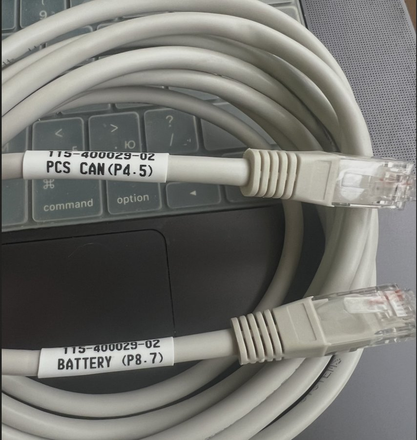
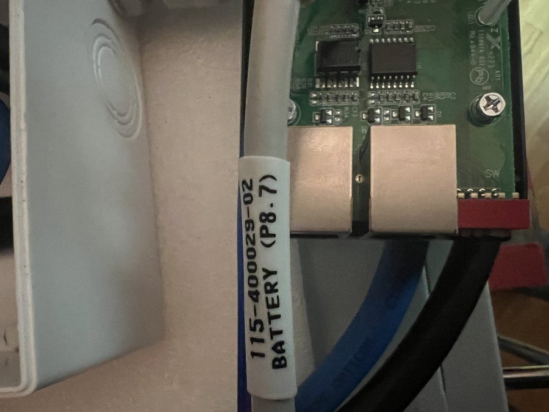
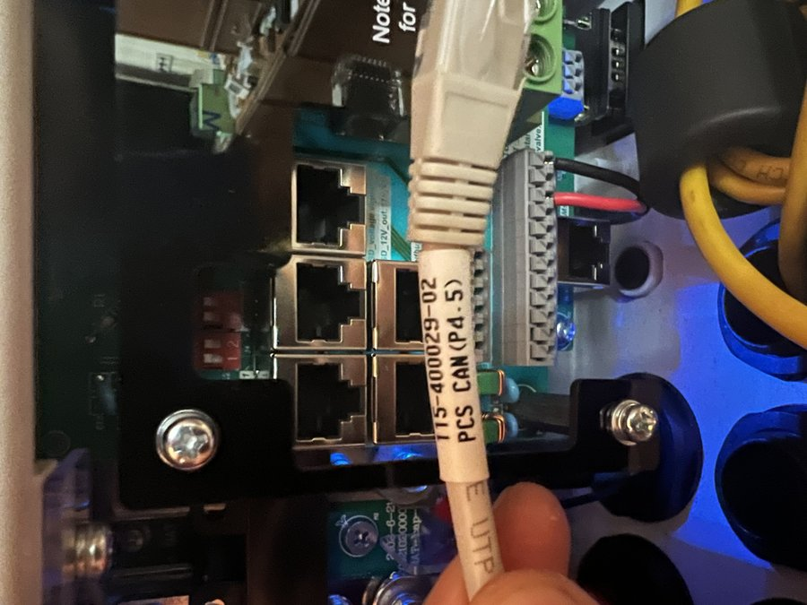
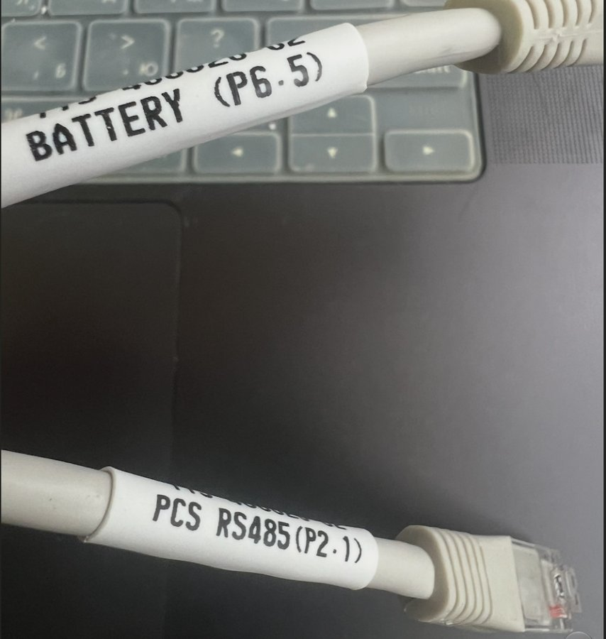
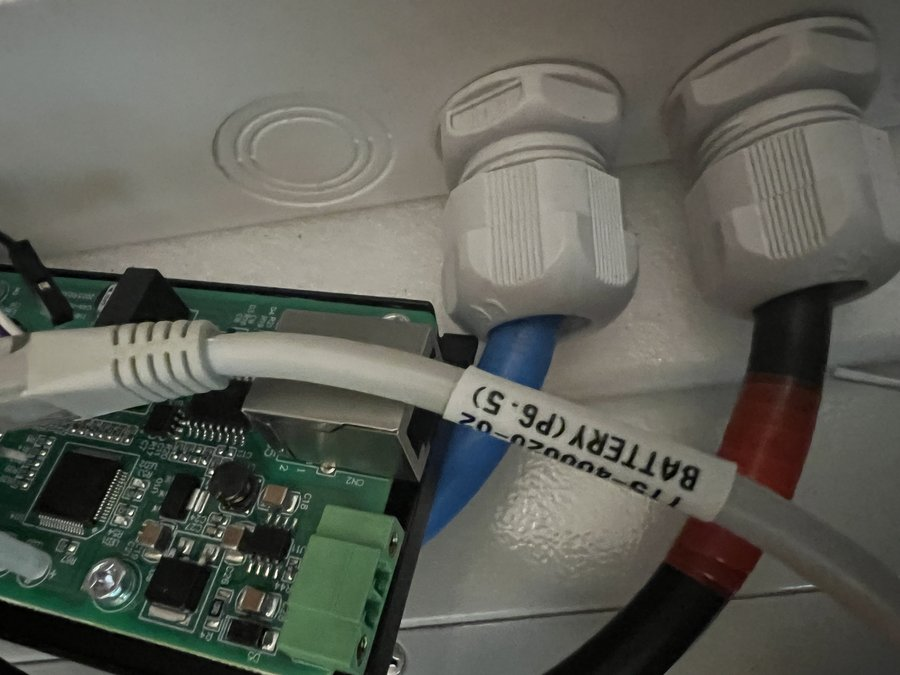
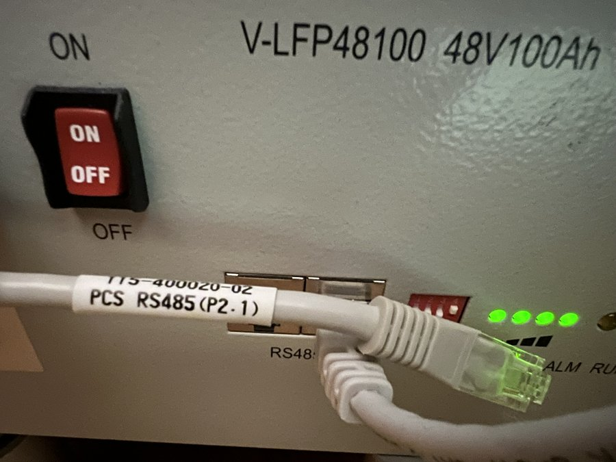

# COM-Box — Прошивка конвертера BMS RS485 → CAN (Deye / Pylontech)

[](https://creativecommons.org/licenses/by-nc-sa/4.0/)

Прошивка PlatformIO для мікроконтролера **GD32F305RCT6** (Cortex-M4F, 256K Flash, 96K RAM), яка виконує роль інтелектуального шлюзу між акумуляторним банком **Vision V-LFP48100 (15S LiFePO4)** та гібридним інвертором **Deye** (протокол CAN Lithium Mode 00: фірмовий `DY001` V3.3 або класичний `Pylontech CAN v2.0.6`, 500 кбіт/с).

Єдине джерело коду прошивки — [`src/main.cpp`](src/main.cpp) (3354 рядки, чистий FSM, без RTOS).

---

## Ліцензія та правовий статус

* **Прошивка та документація** (`src/`, `tools/`, `can_sniffer/`, усі `.md`): поширюються на умовах **[CC BY-NC-SA 4.0](LICENSE)** (Creative Commons Attribution-NonCommercial-ShareAlike 4.0) — вільне некомерційне використання, вивчення та модифікація для особистих потреб; похідні роботи — лише на тих самих умовах. Будь-який комерційний перепродаж прошивки чи пристроїв із нею — заборонено. © 2026 FigVam.
* **Не наше (ліцензія не поширюється):** `lib/GD32F30x/` — GD32/CMSIS-бібліотеки GigaDevice/ARM на їхніх BSD-умовах (див. шапки файлів); `original_firmware/` — матеріали реверсу заводської прошивки, права належать виробнику (використано виключно для дослідження сумісності).
* **Апаратна платформа:** COM-Box — заводський сторонній виріб (Felicity Solar / GD32F305). Автор проєкту не є розробником заліза, не пов'язаний з виробником і не претендує на його інтелектуальну власність. Проєкт є незалежною аматорською aftermarket-прошивкою, створеною для відновлення працездатності та забезпечення сумісності обладнання. Надається за принципом «як є» (AS IS), без будь-яких гарантій.
* **Торгові марки:** Deye, Pylontech, Vision, Felicity Solar, GigaDevice та інші назви брендів належать їхнім законним правовласникам і використовуються виключно для опису сумісності обладнання.

---

## Хто що: простий опис коробки та прошивки

**Що це за коробка.** COM-Box — це невеликий перекладач між вашими акумуляторами і сонячним інвертором Deye. Акумулятори Vision і інвертор говорять різними «мовами» (різні способи обміну даними) і напряму одне одного не розуміють. Коробка стоїть між ними, весь час перекладає та стежить за безпекою. Усередині — власна прошивка (не заводська), яка повністю керує розмовою «батарея ↔ інвертор».

**Що прошивка робить постійно, сама:**
1. Опитує кожен акумуляторний блок (до 16 штук поспіль) і збирає спільні цифри: загальна напруга, поточний струм, рівень заряду, найгарячіша температура.
2. Перекладає ці цифри у формат, який розуміє інвертор, і надсилає їх раз на секунду.
3. Дивиться на **кожну окрему комірку** (у блоці їх 15) і сама обмежує заряд або розряд, коли щось виходить за безпечні межі: комірка надто заряджена або розряджена, спека чи мороз, велика різниця між комірками.
4. Якщо зв'язок із акумуляторами пропав (кілька секунд мовчки) — чесно подає нулі на інвертор, щоб той зупинив заряд і розряд. Нічого не вгадує — це навмисно, щоб у разі збою батарея не постраждала.
5. Веде просту індикацію на світлових діодах (LED).

**Що ви можете зробити самі, без комп'ютера (перемикачі на корпусі):**
- **Перемикач 1 (DIP1)** — базовий профіль напруги (коли `DIP2 = OFF`): *вимкнено* (типово) — повний паспортний заряд Vision **54,0 В** (100 %, тейпер 3.450..3.600 В); *увімкнено* — буферний/Float режим **51,0 В** (довговічне зберігання без перезаряду, тейпер 3.380..3.420 В; перекривається при `DIP2 = ON`).
- **Перемикач 2 (DIP2)** — профіль Victron **53,2 В** (**має пріоритет над DIP1**): *вимкнено* — діє вибір DIP1 (`54,0 В` або `51,0 В`); *увімкнено* — канонічний профіль Victron/Pylontech 15S **53,2 В** (тейпер 3.440..3.560 В), незалежно від положення DIP1.
- **Перемикач 3 (DIP3)** — діагностичний роз'єм інвертора (`PCS-485`): *вимкнено* (типово — рекомендовано для щоденної роботи) — пасивне дзеркало обміну коробка ↔ BMS; *увімкнено* — дослідницький прозорий «міст» інвертор ↔ акумулятор (власне опитування коробки вимикається). Швидкісний автопошук **`Smart Plug & Play`** (цикл ~800 мс для 2 блоків, таймаут живого блоку 600 мс, фонове виявлення кожні 2 с з пріоритетом для відключених блоків) працює **завжди автоматично**.
- **Перемикач 4 (DIP4)** — режим обмеження струму заряду на один блок: *вимкнено* (типово) — **50 А** (повний паспортний струм), *увімкнено* — **15 А** (ощадливий режим 0.15C, повна тиша та мінімум нагріву проводки).
- **Перемикач 5 (DIP5)** — імпульсне балансування-гойдалка: *вимкнено* (типово) — штатна робота **без гойдалки** (`CVL` залишається сталим на напрузі активного профілю, зупинка через `CCL = 0`, вихід зі стопу при струмі розряду > 10 А без брязкоту); *увімкнено* — імпульсна гойдалка **«мікрозаряд ↔ мікророзряд»** (`54,0 ↔ 52,2 В`, `53,2 ↔ 52,2 В` або `52,2 ↔ 51,0 В` залежно від активного профілю DIP1/DIP2; LED1 блимає 1 Гц).
- Перемикати можна під роботою, без вимкнення — коробка помітить зміну за частку секунди.
- Вмикати/вимикати самі блоки акумуляторів — коробка перерахує все під кількість блоків, які відповідають.

**Індикація (світлові діоди):** зовнішній діод із правого боку — живлення й робота системи (горить постійно); інші зовнішні діоди блимають лише тоді, коли йде обмін даними — з акумуляторами, з інвертором або на діагностичному роз'ємі (`DIP3`); стан зарядного режиму (54,0 В / 53,2 В / 51,0 В / балансування) показує окремий діод `LED1` усередині корпуса. Таблиця діодів — [`PORT_MAPPING.md`](PORT_MAPPING.md#23-світлодіодна-індикація-led-16) §2.3.

**Вирівнювання (балансування) комірок.** Комірки в блоці заряджаються трохи нерівномірно. У штатній роботі (`DIP5 = OFF`) коробка тримає сталу напругу вибраного профілю (**54,0 В**, **53,2 В** або **51,0 В**), не знижує `CVL` у 51,0 В після зупинки заряду й проводить авто-сесії вирівнювання за таймерами та дельтою комірок (`52,2 В`, 2.0–5.0 А на банк, `0x35C` `0x88`, CAN-SOC ≤ 98%). При увімкненні **`DIP5 = ON`** запускається імпульсна гойдалка: коробка чергує фазу мікророзряду (мінімум 8 с, максимум 25 с, `CCL = 0`, поштовх `51,5 В` за потреби) та мікрозаряду (до 5 А на банк, із пробудженням `FC06 0x002A` кожні 3 с) у межах активного профілю (**`54,0 ↔ 52,2 В`**, **`53,2 ↔ 52,2 В`** або **`52,2 ↔ 51,0 В`**), примусово розхитуючи пасивні балансири BMS без ризику перезаряду. Деталі алгоритму — [`BALANCE_AUTO.md`](BALANCE_AUTO.md); історія проєкту — [`PROJECT_HISTORY.md`](PROJECT_HISTORY.md), відкриті завдання — [`UNRESOLVED_PROPOSALS.md`](UNRESOLVED_PROPOSALS.md).

**З чого почати читати далі:**
- нижче, «⚡ Огляд системи» — стислий технічний перелік для інженера;
- **§5** — що програма робить по черзі під час роботи;
- **§7** — усі версії прошивки в порядку дат (там і повний опис вирівнювання);
- **§8 і §9** — що вже перевірено, що лишилося невідомим;
- [`PORT_MAPPING.md`](PORT_MAPPING.md) — апаратний мапінг плати V1.3, піни, кабелі, DIP1..5 та LED1..6;
- [`VISION_BMS_PROTOCOL.md`](VISION_BMS_PROTOCOL.md) — протокол Modbus RTU BMS Vision, FSM та карта регістрів 0..135;
- [`DEYE_INVERTER_CAN_RS485.md`](DEYE_INVERTER_CAN_RS485.md) — протоколи інвертора Deye (`CAN`, `RS485`, `Solarman`);
- [`SAFETY_AND_ALARMS.md`](SAFETY_AND_ALARMS.md) — повний опис аварійних сигналів, бітів та реакцій коробки;
- [`BALANCE_AUTO.md`](BALANCE_AUTO.md) — профілі напруг, Pre-Taper `3420 мВ`, авто-баланс та гойдалка `DIP5`;
- [`PROJECT_HISTORY.md`](PROJECT_HISTORY.md) — хронологія розробки, польових тестів і матриця Q1–Q26;
- [`UNRESOLVED_PROPOSALS.md`](UNRESOLVED_PROPOSALS.md) — відкриті пропозиції та 12 інженерних табу.

---

## ⚡ Огляд системи та реалізовані можливості

```
[Батареї Vision 15S]  <-- RS485 (Modbus RTU 9600) -->  [ COM-Box ]  <-- CAN (500 kbps, 1 Hz) -->  [Інвертор Deye]
(до 16 модулів паралельно)                               (GD32F305)                                 (Lithium Mode 00)
```

- **Агрегація до 16 акумуляторів**: опитування адрес `0x01…0x10` (Modbus FC03, reg 0, qty 39, 83 байти), **SOC з напруги комірок** (див. §6, кадр `0x355`), середній SOH, сумарний струм, екстремуми напруг і температур.
- **Багаторівнева батарейна безпека (Фаза 1, 15.10.2026)**:
  - **Захист від перерозряду (Q19)**: постійний пошук `min_cell_mv`. Превентивний Soft Warning (50% DCL + 0x359 Warning Cell UV) при `<= 2900 мВ`, повне відсікання розряду (`DCL = 0`, `0x35C bit 6 = 0`, 0x359 Protect Cell UV) при `<= 2750 мВ` (буфер 250 мВ до апаратного Protect BMS 2500 мВ для запобігання дуговому удару по ключах під навантаженням). Гістерезис відновлення `>= 3000 мВ` (відповідає `Cell UV Release` BMS).
  - **Температурний захист коміркових NTC (Q20)**: моніторинг `t_amb` (reg 19), `t_cell_max` (reg 20) та 4 коміркових NTC `Temp01..04` (regs 33..34) із саніті-фільтром (-40..120 °C), окремо від `Temp PCB` (reg 18). Блокування заряду (`CCL = 0`) при `T_min < 2 °C` (захист від холодної металізації літію) з гістерезисом відновлення `>= 3 °C`, та при `T_max >= 55 °C` (`DCL = 0` та `OT Protect` при `>= 60 °C`). Системний аварійний біт `Charge UT` у 0x359 відділений від софтового холодового інгібіту і виставляється лише при апаратному захисті BMS (`r27 & 0x0400`), що запобігає хибному зимовому вимкненню розряду інвертором.
  - **Чесні аларми у 0x359 із фільтром Boot Latch (Q17)**: читання регістрів 25..28; фізична перевірка напруг (фіксований поріг `>= 3600 мВ` для Cell OV, відв'язаний від обраного DIP-профілю) блокує транзиторні стартові прапорці BMS, запобігаючи хибним аваріям інвертора під час запуску або при роботі у профілях 53.2 / 51.0 В.
  - **Стійкість до завад і затримок BMS (Q21)**: `6-miss` дебаунс (`pack_miss_count`) захищає як кількість блоків (`0x35E` / `0x364`), так і `charge_ok`/`discharge_ok` кожного блоку (`DCL`/`CCL` не стрибають при поодиноких затримках RS485) ([`PROJECT_HISTORY.md`](PROJECT_HISTORY.md)).
- **Апаратні профілі DIP-перемикачів (оновлено 14.11.2026)**:
  - **SW1 (PB12)**: базовий профіль напруги заряду (коли `DIP2 = OFF`) — `OFF` (типово) → **54.0 В** (паспорт Vision 100%, тейпер 3.450 / 3.600 / 3.550 В), `ON` → **51.0 В** (буферний Float, тейпер 3.380 / 3.420 / 3.380 В; перекривається при `DIP2 = ON`).
  - **SW2 (PB13)**: **пріоритетний профіль Victron 53.2 В** — `OFF` → діє вибір `SW1`, `ON` → **53.2 В** (профіль Victron/Pylontech 15S, тейпер 3.440 / 3.560 / 3.500 В; **перекриває `SW1` незалежно від його положення**).
  - **SW3 (PB14)**: режим другого RS485-порта `PCS-485` — `OFF` → **дзеркало** обміну коробка ↔ BMS, `ON` → **суцільний міст** інвертор ↔ акумулятор, коробка власних команд не шле (для промислової роботи — завжди `OFF`). Швидкісне опитування **`Smart Plug & Play`** (таймаут 600 мс для живих блоків, 80 мс для порожніх адрес, фонове автовиявлення кожні 2 с з пріоритетом `lost_pack_mask`) працює **завжди автоматично**.
  - **SW4 (PB15)**: **режим обмеження струму заряду на модуль** (оновлено 04.11.2026) — `OFF` (типово) → **50 А** (максимум Vision), `ON` → **15 А** (ощадливий режим 0.15C, зниження теплового навантаження в 11 разів).
  - **SW5 (PC6)**: **імпульсне балансування-гойдалка** (оновлено 14.11.2026) — `OFF` → штатна робота **без гойдалки** (`CVL` залишається сталим на напрузі активного профілю, поріг виходу з OV-стопу підвищено до 10.0 А, авто-балансування за розкладом); `ON` → **імпульсна гойдалка «мікрозаряд ↔ мікророзряд»**: `54.0 ↔ 52.2 В` / `53.2 ↔ 52.2 В` (з поштовхом пробудження `51.5 В`) або `52.2 ↔ 51.0 В` (мікророзряд 8..25 с з `CCL=0`, мікрозаряд до 5.0 А на банк із CAN `0x35C = 0x88` та CAN-SOC ≤ 98%, LED1 блимає 1 Гц).
  - Опитування кожні 250 мс з дебаунсом: динамічне перемикання профілів без перезавантаження.
- **Міжблочний захист від перекосу напруг паків (29.10.2026)**:
  - При роботі $\ge 2$ паралельних блоків контролюється різниця $\Delta U_{packs} = V_{max\_pack} - V_{min\_pack}$.
  - При $\Delta U_{packs} > 1.50\text{ В}$ ліміти `CCL` та `DCL` знижуються на 50%; при $\Delta U_{packs} \ge 3.00\text{ В}$ заряд і розряд блокуються (`0 А`, `0x35C = 0x00`, відновлення при $< 2.50\text{ В}$).
- **Пасивний динамічний CCL (захист від 1C при блокуванні паків, 27.10.2026)**:
  - Коробка контролює стан зарядних ключів кожного блоку (`r1B & 0x1000` Float stop / Standby, тривоги Cell OV / Pack OV / Charge OC / Charge OT / Charge UT / Hardware).
  - Якщо блок закрив заряд — він **виключається з підрахунку CCL** (`agg_charge_capable_count`). Загальний струм інвертора динамічно масштабується лише на реально відкриті блоки, запобігаючи небезпечному навантаженню залишеного робочого блоку струмом 1C (100 А замість 50 А). При 0 відкритих блоках — fail-closed `CCL = 0 А`.
- **Неблокуючий RS-485 кінцевий автомат (FSM, 27.10.2026)**:
  - Попередній блокуючий цикл `bms_receive_response()` замінено на асинхронний FSM `bms_poll_step()`.
  - Цикл `while(1)` виконується за частки мікросекунди без очікувань; кадри CAN передаються строго щосекунди із субмілісекундною точністю (0 джитер для інвертора Deye).
- **Порт PCS-485 (UART4, оновлено 14.11.2026 на DIP3)**: пасивне байтове дзеркало власного RS485-обміну на діагностичний роз'єм (`DIP3 = OFF`) або суцільний прозорий міст «інвертор → BMS → інвертор» (`DIP3 = ON`) — **власний опит у режимі мосту вимкнено повністю**, а транзитні відповіді BMS парсяться для годування CAN/агрегації (далі лише валідні FC03/FC04 із CRC — записи й шум відкидаються). LED3 (PC4) блимає на кожному байті. **⚠️ Міст — діагностичний режим (реверс-інжиніринг RS485-порта Deye); у промисловій роботі DIP3 вимкнено**, бо через міст інвертор бачить сирі дані паків, минаючи агреговані ліміти/stop-tap коробки (мотиви 13.10 — [`DEYE_INVERTER_CAN_RS485.md`](DEYE_INVERTER_CAN_RS485.md) та [`UNRESOLVED_PROPOSALS.md`](UNRESOLVED_PROPOSALS.md)).
- **Баланс-сесії та імпульсна гойдалка (оновлено 14.11.2026; `BAL_AUTO_ENABLED = 1`)**:
  - **DIP5 OFF (штатна робота без гойдалки)** → коробка утримує стале `CVL` обраного профілю (**54.0 В**, **53.2 В** або **51.0 В**), не знижує `CVL` у 51.0 В після зупинки заряду, а також постійно аналізує розкид комірок
    (авто-частота: проблема ≥100 мВ → раз на 24 год, 40–100 мВ → 72 год (3 доби), норма <40 мВ → раз на 30 діб або не частіше 1 разу на 14 діб до 90 хв у буфері `51.0 В`;
    тренд ≥10 мВ/добу або зміна складу паків → «проблема»);
  - за умов (SOC ≥ 85 %, немає розряду, температура 0…45 °C, дійсні дані BMS, кулдаун 12 год)
    стартує **авто-сесія** з адаптивним Float Hold (**CVL 52.2 В, CCL 2.0–5.0 А × N зі стелею банку 5.0 А**) та утриманням інвертора (CAN `0x35C` `0x88`, CAN-SOC ≤ 98%);
  - **DIP5 ON (імпульсне балансування-гойдалка)** → негайний старт гойдалки між активним профілем та **52.2 В** (`54.0 ↔ 52.2`, `53.2 ↔ 52.2` із пробудженням `51.5 В`, або `52.2 ↔ 51.0 В`) із чергуванням фаз мікророзряду (`8..25 с`, `CCL=0`) та мікрозаряду (таймаут 45 с, до 5.0 А на банк);
  - вихід авто-сесії: розкид ≤40 мВ (3 цикли поспіль) → успіх; інакше — втрата BMS ≥8 с, стійкий розряд ≥1,5 А ~60 с (блекаут), «немає прогресу» 90 хв або таймаут 8 год (кулдаун 12 год);
  - **LED1 (PC13)**: блимає ~1 Гц = активна баланс-сесія або гойдалка `DIP5`, суцільний = профіль `51.0 В` (`DIP1 ON`, `DIP2 OFF`) у режимі спокою, вимкнений = штатна робота `54.0 В` (Vision) або `53.2 В` (`DIP2 ON`, Victron);
  - 18.10.2026 завершено випробування слабкої комірки 7 пака 0x03 (вердикт А — дефект корисної ємності, без саморозряду), авто-сесії увімкнено (`BAL_AUTO_ENABLED = 1`), деталі — [`BALANCE_AUTO.md`](BALANCE_AUTO.md).
- **Надійність**: чесний fail-closed стан (через 8 с без відповідей BMS струми 0 А, `0x35C = 0x00`, SOC 0; з 23.10.2026); апаратний Watchdog (FWDGT ≈3.13 с номінал, 2.56 с мін.); авто-відновлення CAN шини.
- **Подвійна ціль збірки**: автономний образ (`0x08000000`) та образ застосунку під заводський bootloader (`0x08004000`) із магічним заголовком `G5RC`.

---

## 1. Карта документації та структура проєкту

| Категорія | Файл | Призначення |
|---|---|---|
| **Ядро розробки** | [`README.md`](README.md) | Цей файл: головний огляд, апаратура, піни, збірка, безпека |
| | [`LICENSE`](LICENSE) | Ліцензія **CC BY-NC-SA 4.0**: обсяг, некомерційність, застереження щодо заліза |
| **Інженерні довідники** | [`PORT_MAPPING.md`](PORT_MAPPING.md) | Апаратний мапінг плати V1.3 (`GD32F305`), розпіновка RJ45/кабелів, `DIP1..5`, `LED1..6`, таймінги шин |
| | [`VISION_BMS_PROTOCOL.md`](VISION_BMS_PROTOCOL.md) | Архітектура та протокол BMS Vision (`V10R18`): FSM, `BMS_TOOLS`, повна карта регістрів `0..135` |
| | [`DEYE_INVERTER_CAN_RS485.md`](DEYE_INVERTER_CAN_RS485.md) | Протоколи інвертора Deye: Pylontech/V3.3 CAN `500 кбіт/с`, прямий RS485 `REV1.30`, `PCS-485`, `Solarman` |
| | [`SAFETY_AND_ALARMS.md`](SAFETY_AND_ALARMS.md) | Захисні пороги, 3-рівнева класифікація аварій, мапінг бітів `r25..r28` ↔ `0x359`/`0x35C`, коди `LED1` |
| | [`BALANCE_AUTO.md`](BALANCE_AUTO.md) | Профілі `54.0 / 53.2 / 51.0 В`, Pre-Taper `3420 мВ`, авто-баланс `Float Hold 52.2 В`, гойдалка `DIP5` |
| **Журнал і беклог** | [`PROJECT_HISTORY.md`](PROJECT_HISTORY.md) | Хронологія розробки (`08.10..19.11.2026`), польові тести з Deye, аудит комірок, матриця `Q1–Q26` |
| | [`UNRESOLVED_PROPOSALS.md`](UNRESOLVED_PROPOSALS.md) | Пріоритезований беклог відкритих пропозицій та 12 непорушних інженерних табу |
| **Утиліти та дослідження** | [`original_firmware/ORIGINAL_FIRMWARE.md`](original_firmware/ORIGINAL_FIRMWARE.md) | Повний реверс-інжиніринг заводської прошивки Felicity Solar G5RC (1400+ рядків) |
| | [`can_sniffer/README.md`](can_sniffer/README.md) | CAN-сніфер для ESP32 (режим ACK) та Arduino Nano для тестування COM-Box без інвертора |
| | [`tools/bms_web.py`](tools/bms_web.py) | Мульти-пакова веб-станція моніторингу та діагностики (v3.6): автопошук 1..16, графіки, $R_{int}$, уставки інвертора, алярм-хелпер, CSV-логування Alarm/State/Work, офлайн-аналізатор логів, A4 PDF-звіт |
| | [`tools/can_sniff.py`](tools/can_sniff.py) | Пасивний/активний сніфер CAN-шини інвертора Deye/Pylontech (SLCAN / WeAct USB2CAN V2) з повним декодом кадрів `DY001` (`0x351..0x371`, `0x110..0x65F`) і `PYLON` |
| | [`tools/rs485_sniff.py`](tools/rs485_sniff.py) | Пасивний сніфер батарейної шини Modbus RTU з авто-декодом полів Vision |
| | [`detect_probe.py`](detect_probe.py) | Автоматичне апаратне визначення типу підключеного програматора (DAPLink CMSIS-DAP / ST-Link) для PlatformIO |
| | [`tools/verify_dump.py`](tools/verify_dump.py) | Регресійні тести парсера BMS на реальних фікстурах дампів (`--selftest`, `--queries`) |

---

## 2. Збірка та інструменти

```bash
pio run          # збірка обох env + generate_hex.py копіює артефакти
pio run -e genericGD32F305      # лише автономна збірка (перезаписує compiled_firmware/)
pio run -e genericGD32F305_app  # лише образ під заводським bootloader'ом (compiled_firmware_app/)
```

- **Два режими прошивки**:
  - `genericGD32F305` — автономний образ на `0x08000000`, **стирає заводський bootloader** (відновлення: [`original_firmware/combobox_bkp_40000.bin`](original_firmware/combobox_bkp_40000.bin) → 0x08000000 через ST-Link/DAPLink).
  - `genericGD32F305_app` — образ на **`0x08004000`** (регіон **192 КБ**): ST-Link/DAPLink пише лише область застосунку, заводський bootloader `0x08000000..0x08003FFF` зберігається. `generate_hex.py` автоматично прописує магічний dword `G5RC` на зсуві `0x150` (bootloader перевіряє `0x08004150` та валідність початкового SP).
- **Автоматичне визначення програматора (ST-Link / DAPLink)**: завдяки пре-скрипту [`detect_probe.py`](detect_probe.py) PlatformIO перед завантаженням опитує USB-шину. Якщо виявлено WeAct DAPLink (CMSIS-DAP) — автоматично активується `upload_protocol = cmsis-dap` (швидкість SWD 4 МГц); якщо ST-Link — `upload_protocol = stlink`. Обидва типи відладчиків працюють без ручного редагування конфігурації.
- **Актуальні характеристики збірки (19.11.2026, `pio run`, обидва env):**
  - **Flash**: **24 916 Б** у `.bin` (у звіті `pio run` — `24 416 Б`, `9.3%` від `256 КБ`; `12.7%` від `192 КБ` області App).
  - **RAM**: **4 152 Б** (`data + bss` за `arm-none-eabi-size`, `4.2%` від `96 КБ`; у звіті `pio run` — `2 600 Б`, `5.3%` від `48 КБ` STM32F103RC).
- **⚠️ `pio run` перезаписує `compiled_firmware/firmware.bin/.hex`** — перед збіркою зробіть бекап, якщо поточний бінарник потрібен.
- `compiled_firmware/firmware.bin` і `.hex` оновлюються автоматично після кожного білда.
- Історична порівняльна збірка (dpsk8) займала 8716 Б Flash / 1140 Б RAM.
- **⚠️ Інтеграція з редактором**: `pio project init --ide vscode` перегенерує
  `.vscode/c_cpp_properties.json` **з порожніми `""`-елементами** у `defines`,
  `compilerArgs` і `browse.path` — через них cpptools відкидає конфігурацію і
  показує ~22 хибні помилки (`'gd32f30x.h' file not found`, `Unknown type name 'uint8_t'`).
  Усувається видаленням цих порожніх рядків із файлу (файл у `.gitignore`, правка локальна).
  Актуальний `compile_commands.json` генерується командою `pio run -t compiledb`.

### Регресія парсера BMS (`tools/verify_dump.py`)

```bash
python3 tools/verify_dump.py --selftest   # синтетичний дамп + знаковий струм + CRC + довжина
python3 tools/verify_dump.py --queries    # CRC усіх 48 запитів (BMS_QUERY/SEARCH/WAKEUP_QUERY_TABLE з src/main.cpp)
python3 tools/verify_dump.py tools/dumps/<file>.hex   # реальний дамп: один кадр на рядок, hex
python3 tools/verify_dump.py - "01 03 4E ... 7A CC"   # кадр із рядка
```

- Декод полів — точно за розкладом `bms_parse_response()` (83 байти, `[2]=0x4E`,
  SOC/SOH `& 0xFF`, струм int16 BE, температура з реєстру 0x13; **офсети
  P1.1 від 22.10.2026: SOC = рег 0x18 → [51],[52], SOH = рег 0x17 → [49],[50]**).
- Запускати **після будь-якої правки парсера** — виявляє зсув байтів, який
  «проходить CRC», але читає SOC із температури.
- Exit-код ≠ 0 = є помилка (зручно для CI/ручного чек-ліста).
- `tools/dumps/2026-10-08_pack01.hex`, `..._pack02.hex` — **золоті фікстури**
  з реальних логів BMS Tools (08.10.2026): по 2 унікальні кадри даних
  (усі комірки 3297 мВ; варіант 3296 мВ у комірці #2) і кадр моделі
  для кожної адреси (CRC `7A CC`/`BE F0` і `B6 B4`/`72 88`, моделі
  `FE CA`/`89 BD`). **`--selftest` перевіряє їх автоматично** —
  після правки парсера запускати саме `--selftest`.

### RS485-сніфер батарейної шини (`tools/rs485_sniff.py`)

Пасивний (read-only) сніфер Modbus RTU на шині батарей: декодує опитування інвертора
(`FC03 0x00 qty=28`, `FC03 0x50 qty=2`), wakeup-запити (`FC06 0x002A`) і нашого box (`qty=0x27`), мапу Vision
(V/I/комірки/t/SOC/SOH/r19..r26), модельний ASCII; пише у
`deye/logs/rs485/rs485_sniff_<timestamp>.log` (формат рядків — як у логу 09.10.2026).

```bash
python3 tools/rs485_sniff.py --list                       # порти
python3 tools/rs485_sniff.py --port /dev/cu.usbserial-XXX # 9600 8N1, Ctrl-C → підсумок
python3 tools/rs485_sniff.py --selftest                   # синтетичні кадри
```

- Framing по паузі 8 мс, CRC-валідація, ресинк; **валідований реплеєм логу
  09.10.2026: 1291/1291 рядків декодуються ідентично**.
- Сценарій підключення нового модуля: встановити унікальну DIP-адресу (0x03) → підключити окремо →
  заряд із запущеним сніфером (закриває Q17/Q18) → ΔU < 0.5 В → під'єднувати паралельно.

### CAN-сніфер шини інвертора (`tools/can_sniff.py`)

Універсальний сніфер та декодер протоколу Deye/Pylontech (500 кбіт/с) для USB-адаптерів з протоколом SLCAN (зокрема **WeAct Studio USB to CAN Module V2**, STM32G431, ізоляція 2500 В):
- **Автовиявлення адаптера:** автоматично знаходить WeAct USB2CAN V2 за VID:PID (`0x0483:0x5740`) без ручного введення портів.
- **Два режими шини:**
  * `NORMAL` (за замовчуванням, з ACK): ідеально для лабораторного стенда без інвертора (запобігає зависанню COM-Box на auto-retransmit першого кадру).
  * `LISTEN-ONLY` (`--listen-only` / `-l`): повністю пасивний режим моніторингу робочої шини, підключеної до інвертора Deye.
- **Повне декодування кадрів:**
  * `0x351`: ліміти заряд/розряд (CVL, CCL, DCL, DVL);
  * `0x355`: SOC (%) та SOH (%);
  * `0x356`: напруга (0.01 В), знаковий струм (0.1 А, заряд/розряд), середня температура (0.1 °C);
  * `0x359`: біти захистів і попереджень (Deye V3.3 Tables 1–7 або Pylontech v2.0.6);
  * `0x35C`: біти дозволів та балансування (`Request Full Charge`);
  * `0x35E`: назва бренду та ємність (`'DY001'` або `'PYLON   '`), а також поблокові кадри `0x361/363/364/371` та `0x110+i..0x650+i`;
  * `0x305`: час інвертора Deye (PCS Time).

```bash
python3 tools/can_sniff.py --selftest                   # перевірка декодера на синтетичних векторах
python3 tools/can_sniff.py --list                       # список доступних портів
python3 tools/can_sniff.py                              # автовиявлення WeAct + режим стенда (з ACK)
python3 tools/can_sniff.py --listen-only                # пасивний моніторинг шини з інвертором
python3 tools/can_sniff.py --duration 60 --out deye/logs/can/can.log
```
*(Для користувачів мікроконтролерів ESP32 або Arduino Nano також доступний окремий скетч у каталозі [`can_sniffer/`](can_sniffer/README.md)).*

### Веб-станція моніторингу та діагностики (`tools/bms_web.py`)

Потужна локальна станція моніторингу та інженерної діагностики (v3.6, 14.11.2026) для банку акумуляторів Vision V-LFP48100 (до 16 блоків). Потребує Python 3 і **pySerial** для роботи з реальним COM-портом (`pip3 install pyserial`); графіки — Vanilla JS / HTML5 Canvas, без зовнішніх JS-бібліотек. Повна документація — [`tools/BMS_WEB_README.md`](tools/BMS_WEB_README.md).

```bash
# Універсальний запуск (Windows / macOS / Linux) — розумний автопошук порту!
python tools/bms_web.py          # на Windows
python3 tools/bms_web.py         # на macOS / Linux

# Запуск одразу в пасивному режимі (паралельно з працюючим інвертором / COM-Box):
python3 tools/bms_web.py --passive

# Демо-режим (симуляція кількох АКБ, графіків та діагностики без заліза):
python3 tools/bms_web.py --mock
```
*Адреса в браузері:* **`http://127.0.0.1:8080`**

- **Розумне автовизначення COM/USB порту**: самостійно знаходить перехідники RS-485 на чіпах FTDI FT232, WCH CH340, Silicon Labs CP210x, Prolific на Windows (`COMx`), macOS (`/dev/cu.usbserial*`) та Linux (`/dev/ttyUSB*`).
- **Мульти-паковий скан (0x01..0x10)**: стартовий прогін 16 адрес (~1.8 с), перехід на швидкісне опитування лише наявних блоків (0.35 с), фоновий Plug & Play (hot-plug) та виключення відключених батарей (hot-unplug).
- **⚙️ Розумний калькулятор уставок інвертора**: кнопка у шапці автоматично розраховує безпечні уставки заряду/розряду під точну кількість АКБ для Deye / Victron / Luxpower з копіюванням конфігу в 1 клік.
- **🚨 Інтерактивний довідник алярмів (Alarm Helper)**: клікабельні бейджі статусів та тривог із відкриттям картки фізичної першопричини та інженерного алгоритму усунення.
- **Два режими роботи (перемикання кнопкою в UI)**:
  - `⚡ Активний Master`: опит шини запитами `FC03 qty=39`, читання моделі/FW/серійного номера (`FC03 start=0x69`).
  - `👂 Пасивний Sniffer`: нуль передач у шину (повна тиша), безпечна робота паралельно з інвертором або COM-Box без колізій.
- **4-рівнева система вкладок**:
  - `📊 Загальний огляд`: напруга, струм, потужність, накопичена енергія в кВт·год, заводський та реальний фізичний OCV-SOC (%), калькулятор автономності (Time to Full / Time to Empty), картка **Weakest Cell Tracker** та зведена таблиця всіх блоків.
  - `📈 Графіки та Діагностика`: плавний живий тренд V/I/P/Δ на Canvas, гістограма 15 комірок із виділенням Min/Max, сяючим пульсуючим бейджем `[BAL]` для активних балансирів та розрахунком динамічного внутрішнього опору $R_{int}$ (мОм).
  - `🔋 АКБ 0x01..0x10`: окремі вкладки з повною телеметрією кожного акумулятора (15 комірок, 3 NTC, інтерактивні регістри Status/Warning/Protect/Error, лічильник циклів, SN, FW).
  - `📂 Аналіз логу`: офлайн-аналізатор збережених CSV-файлів (Drag & Drop) з повним графіком сеансу та аудитом стану комірок.
- **📄 Паспорт-звіт у PDF**: кнопка «Діагностичний звіт» формує готовий паспортний звіт банку, оптимізований точно під **1 сторінку A4** для друку або збереження у PDF (`window.print()`).
- **Суворий Read-Only**: ніколи не надсилає команди запису (FC06/FC10), 100% безпека для налаштувань BMS.

---

## 3. Годинник і шини (перевірено дизасемблюванням / даташитом)

| Перемінна | Значення | Підтвердження |
|---|---|---|
| Ядро | **HSI (IRC8M) 8 МГц**, `SystemCoreClock = 8000000`, SysTick 1 мс | `SystemInit` (`system_stm32f1xx.c`) скидає RCC; власний `main()` не викликає `SystemClock_Config` |
| **CAN** | **500 кбіт/с**: prescaler=1, SJW=1TQ, BS1=11TQ, BS2=4TQ → 16 TQ × 8 МГц | константа `word0 = 0x030A0000` у зібраному бінарнику |
| **RS485 (BMS)** | **9600 8N1**, без парності | `usart_baudrate_set` від RCU APB2 = 8 МГц → BRR ≈ 833 (9603 бод, +0.04%) |
| MCU | GD32F305RCT6 = **96K SRAM / 256K Flash** | даташит; лінкер коректний |

**Виміряно вручну на реальній шині: 500 кбіт/с** (BTR = `0x030A0000`).
Значення 250 кбіт/с не підтвердилося і не розглядається — питання закрито назавжди.

---

## 4. Піни та роз'єми

### 4.1. Зовнішні роз'єми корпусу (підключення кабелів)

> Підтверджено реверс-інжинірингом заводської документації (`original_firmware/ORIGINAL_FIRMWARE.md` §14.7), довідником [`DEYE_INVERTER_CAN_RS485.md`](DEYE_INVERTER_CAN_RS485.md) та продзвонюванням кіл [`PORT_MAPPING.md`](PORT_MAPPING.md).
>
> ⚠️ **Критично (Правило 10 [`UNRESOLVED_PROPOSALS.md`](UNRESOLVED_PROPOSALS.md))**: пін 1 (GND) обов'язковий до підключення на всіх сигнальних лініях RJ45 для вирівнювання потенціалів та захисту трансиверів від синфазних завад і зрівняльних струмів.

| Роз'єм | Призначення | Розпіновка (RJ45, піни 1..8) | Параметри шини |
|---|---|---|---|
| **BMS-485** | Підключення до шини акумуляторів Vision V-LFP48100 | **Пін 1**: GND<br>**Пін 5**: RS485-B (Data−)<br>**Пін 6**: RS485-A (Data+)<br>*(інші піни NC)* | Modbus RTU, **9600 8N1**, напівдуплекс (авто-напрямок) |
| **PCS-CAN** | Підключення до CAN-порту інвертора Deye (BMS CAN) | **Пін 1**: GND<br>**Пін 7**: CAN-L<br>**Пін 8**: CAN-H<br>*(розпіновка гнізда COM-Box; в інверторі Deye CAN заведено на піни 4 (CAN-H) та 5 (CAN-L), а піни 1, 2 запаралелені з 7, 8 під RS485 — тому зв'язок з Deye вимагає крос-кабелю: 8→4, 7→5, 1→3; Pin 3 = BMS-GND Deye)* | Deye `DY001` / Pylontech CAN v2.0.6, **500 кбіт/с**, 1 Гц |
| **PCS-485** | Діагностичний порт (`DIP3`): **дзеркало** обміну коробка ↔ BMS при OFF / **суцільний міст** інвертор ↔ акумулятор при ON — без власних команд коробки, CAN годується з парсингу трафіку (Q23, перенесено з DIP2 14.11.2026) | **Пін 1**: GND<br>**Пін 5**: RS485-B (Data−)<br>**Пін 6**: RS485-A (Data+)<br>*(інші піни NC)* | Modbus RTU, **9600 8N1** (UART4, PC12/PD2) |
| **Power (B+ / B−)** | Гвинтовий клемник живлення COM-Box від батарейного банку | **B+**: +15…+60 В DC (через запобіжник)<br>**B−**: GND (мінус батареї) | Споживання плати < 0.5 Вт |

### 4.1.1. Комплектні заводські кабелі та жива схема підключення

У комплекті COM-Box постачаються два спеціальні інтерфейсні кабелі заводського розшиття.

> ⚠️ **КРИТИЧНО:** Ігноруйте заводські написи «BATTERY» чи «PCS» на білих трубках! Орієнтуйтеся **ВИКЛЮЧНО на номери пінів у дужках**: `(P8.7)`, `(P4.5)`, `(P6.5)`, `(P2.1)`.

#### 1. Крос-кабель CAN (COM-Box ↔ Інвертор Deye):
| Маркування бірок | COM-Box: порт `PCS-CAN` `(P8.7)` | Інвертор Deye: порт `BMS` `(P4.5)` |
| :---: | :---: | :---: |
|  |  |  |
| **`P8.7` ↔ `P4.5`** | ➡️ **Штекер `BATTERY (P8.7)`** | ➡️ **Штекер `PCS CAN (P4.5)`** |

* **Куди вмикати:** Штекер `BATTERY (P8.7)` (піни 8, 7) — у роз'єм **COM-Box `PCS-CAN`**; штекер `PCS CAN (P4.5)` (піни 4, 5) — у роз'єм **Deye `BMS`**.

#### 2. Крос-кабель RS-485 (COM-Box ↔ Акумулятор Vision V-LFP48100):
| Маркування бірок | COM-Box: порт `BMS-485` `(P6.5)` | Акумулятор Vision: порт `RS485` `(P2.1)` |
| :---: | :---: | :---: |
|  |  |  |
| **`P6.5` ↔ `P2.1`** | ➡️ **Штекер `BATTERY (P6.5)`** | ➡️ **Штекер `PCS RS485 (P2.1)`** |

* **Куди вмикати:** Штекер `BATTERY (P6.5)` (піни 6, 5) — у роз'єм **COM-Box `BMS-485`**; штекер `PCS RS485 (P2.1)` (піни 2, 1) — у роз'єм **акумулятора Vision `RS485`**.

#### 3. Міжблочне з'єднання акумуляторів:
* Для з'єднання блоків Vision між собою використовується **звичайний прямий комп'ютерний патч-корд RJ45** (1-в-1 T568B).

### 4.2. Фізичні піни мікроконтролера GD32F305RCT6

> Еталон фізичних призначень — [`PORT_MAPPING.md`](PORT_MAPPING.md) (`chmod 444`);
> ця таблиця — робочий опис поведінки **нашої прошивки** на цих пінах.

| Функція | Пін | Режим | Примітка |
|---|---|---|---|
| RS485 TX | PA9 | AF PP | `UART_BMS` = USART0, 9600 |
| RS485 RX | PA10 | Input floating | polling, без IRQ/DMA |
| RS485 DE/RE | — | **відсутній** | трансівери авто-напрямку (без DE/RE, `original_firmware/ORIGINAL_FIRMWARE.md` §14.3); PC5 — це LED CAN, не DE (**з 09.10.2026, LED-ітерація**; раніше керування DE велося на PC5 — помилка) |
| CAN RX | PB8 | Input pull-up | `GPIO_CAN_PARTIAL_REMAP` |
| CAN TX | PB9 | AF PP | CAN0 |
| LED5 «Running» | PB0 | OUT PP | **постійно HIGH** зі старту — «живлення є, прошивка працює» (призначення 17.10.2026) |
| LED6 «BMS-485» | PB1 | OUT PP | HIGH поки триває опитування BMS (запит → прийом), LOW між циклами — блимає лише за наявності обміну |
| LED4 «PCS-CAN» | PC5 | OUT PP | HIGH на час передачі CAN-кадрів `send_all_frames()` + ~100 мс після (`can_led_off_ms`) — «CAN до інвертора» |
| LED3 «inv-RS485» | PC4 | OUT PP | **активність PCS-485 (UART4)**: блимає на кожному байті дзеркала (`DIP3 OFF`) чи мосту (`DIP3 ON`) + 100 мс після (оновлено 14.11.2026) |
| LED1 | PC13 | OUT PP | **стан профілю, баланс-сесії та діагностичні блінк-коди аварій** (оновлено 14.11.2026): серія 2..5 спалахів + пауза 1.4 с (1400 мс) = активна аварія (2=Cell UV ≤ 2.90 В, 3=Temp inhibit / Protect, 4=Imbalance > 400 мВ або паків ≥ 3.0 В, 5=BMS comm loss); блимає ~1 Гц = активна/призупинена баланс-сесія або імпульсна гойдалка (`DIP5 ON`); суцільний = профіль `51.0 В` (`DIP1 ON`, `DIP2 OFF`) у режимі спокою; вимкнений = штатна робота `54.0 В` (Vision) або `53.2 В` (`DIP2 ON`, Victron) |
| Transceiver EN | PB10 / PB11 | OUT PP / OUT OD | стартовий стан як у заводській прошивці (HIGH/HIGH-OD) — можливі enable-входи трансиверів (`original_firmware/ORIGINAL_FIRMWARE.md` §14.4) |
| PC3 | — | **не налаштовується** | не читається/не пишеться в коді |
| DIP (PB12…PB15, PC6) | IN pull-up | DIP1 (SW1, PB12, вага 1): базовий профіль при `DIP2=OFF` — `OFF` → 54.0 В (Vision 100%), `ON` → 51.0 В (буфер Float); DIP2 (SW2, PB13, вага 2): пріоритетний профіль Victron `53.2 В` (`ON` перекриває DIP1 незалежно від його положення); DIP3 (SW3, PB14, вага 4): режим `PCS-485` — `OFF` → дзеркало BMS, `ON` → суцільний міст до інвертора (`Smart Plug & Play` працює завжди автоматично); DIP4 (SW4, PB15, вага 8): струм заряду на модуль — `OFF` → 50 А (стандарт), `ON` → 15 А (ощадливий режим 0.15C); DIP5 (SW5, PC6, вага 16): імпульсне балансування-гойдалка — `OFF` → штатна робота без гойдалки, `ON` → гойдалка `54.0↔52.2`, `53.2↔52.2` або `52.2↔51.0 В` (оновлено 14.11.2026; детально — [`PORT_MAPPING.md`](PORT_MAPPING.md#22-блок-мікроперемикачів-dip-15-опитуються-кожні-250-мс) §2.2) |

---

## 5. Поведінка `main()`

1. `SystemInit()` → SysTick 1 мс → **`dip_charge_profile_init()`** (читання DIP
   PB15…PB12 + PC6 (DIP5) → профіль CVL/тейперу/струму, див. §7) → `leds_init()` →
   `rs485_init()` → **`pcs_uart_init()`** (UART4 9600 8N1, режим `DIP3`: дзеркало/міст)
   → `can_init_500k()` → `watchdog_init()` (FWDGT, див. п. 8).
   У циклі — **`pcs_poll_service()` на кожному проході** (злив дзеркала; при `DIP3 ON` —
   читання UART4 і замикання запиту інвертора по паузі 5 мс) і **`dip_charge_profile_poll()` кожні 250 мс**: зміна DIP ловиться
   без перезавантаження (два однакові читання поспіль = стабільне значення); там само
   **`pcs_mode_apply()`** (перемикання `DIP3`, відкладене якщо міст зайнятий) і **`balance_led_tick()`** — індикація стану профілю, баланс-сесії та блінк-кодів аварій на LED1.
   `DIP1`/`DIP2` обирають профіль напруги заряду (`54.0 / 53.2 / 51.0 В`, з пріоритетом `DIP2`), `DIP4` — максимальний струм заряду
   на один акумулятор: `OFF` → 50 А (стандарт), `ON` → 15 А (ощадливий режим); `DIP5` — імпульсна гойдалка / штатна робота; `DIP3` — режим `PCS-485`.
2. **Опитування BMS** (лише при `DIP3 OFF`; при `DIP3 ON` власні команди коробка не
   шле взагалі — дані для CAN ідуть із парсингу трафіку мосту):
   - **Період між запитами**: `BMS_POLL_PERIOD_MS = 400 мс` (темп запитів відповідає інвертору Deye).
   - **Таймаут відповіді BMS**: `BMS_TIMEOUT_MS = 600 мс` (очікування першого байта відомого блоку; `80 мс` у `bg_probe` для порожніх адрес; `BMS_RESP_GAP_MS = 12 мс` для закриття часткової/виняткової відповіді).
   - **Міжкадровий інтервал**: `BMS_POLL_GAP_MS = 20 мс` тиші між транзакціями.
   - **Опитування `Smart Plug & Play` (завжди ON)**: при старті за 1.2 с опитує всі адреси коротким Search Device (`0x0069`), миттєво фіксує активні блоки й переходить на їх швидкісне опитування (для 2 блоків цикл 800 мс). Кожні **2 с** фоновий зонд автоматично виявляє нові або втрачені (`lost_pack_mask`) АКБ.
   - **Перед кожним запитом `rs485_flush_rx()`** викидає залишкові байти обірваного кадру з RX-буфера і знімає помилки приймача — інакше старі байти ламають CRC наступного циклу цієї адреси. **DE/RE немає**: трансівер авто-напрямку (`original_firmware/ORIGINAL_FIRMWARE.md` §14.3), код просто відправляє 8 байт (PB1 LED HIGH на час польоту запиту). Після завершення циклу опитування (або швидкого циклу) — `bms_aggregate_data()`.
3. **Неблокуючий прийом `bms_poll_step()` (FSM)** + **`bms_uart_rx_drain()`** усередині `send_can_std()`:
   - чекає до `BMS_TIMEOUT_MS = 600 мс` першого байта (`80 мс` у `bg_probe`);
   - **вихід одразу при 83 байтах** (або через `12 мс` тиші для 61-байтного/exception кадру);
   - **жорсткий дедлайн `900 мс` від старту запиту** — гарантує вихід навіть за безперервного шуму;
   - переповнення буфера 256 → `uart_rx_index = 0`;
   - безперервний дренаж `USART0 RX` під час очікувань у `send_can_std()` повністю виключає апаратний `ORERR` від CAN-пачок;
   - **Fail-closed таймаут**: `BMS_DEFAULT_TIMEOUT_MS = 8000 мс` (`10.5 с` при первинному пошуку без `fast_poll_mask`; `BR_SWEEP_MAX_MS + 2 с` у мості `DIP3`).
4. **Парсинг** `bms_parse_response()`:
   - довжина 61 B (`0x38`) або 83 B (`0x4E`), адреса/FC, **перевірка CRC16 Modbus**
     (`(buf[len-1]<<8)|buf[len-2]`, little-endian у кадрі — правильно);
   - поля: voltage = `([3]<<8)|[4]` /100, current = `([5]<<8)|[6]` як `int16_t` /100,
     **температури:** `t_pcb` (`r18`, `[39..40]`) відокремлено від коміркових датчиків `t_amb` (`[41..42]`), `t_cell_max` (`[43..44]`) та 4 коміркових NTC `Temp01..04` (`[69..72]`),
     **SOH = реєстр 0x17 → байти [49],[50]**, **SOC = реєстр 0x18 → [51],[52]**
     (P1.1, 22.10.2026: **при коректному `r24` транслюється кулонометр BMS (`Smart Coulomb Fallback`), а при зависанні `>= 99%` нижче `CVL − 1.0 В` — 3-режимна адаптивна модель з EMA α = 1/8**),
     `cycles` (`r29..30`), `designed_cap_01ah` (`r37`);
     сирий SOH береться як `& 0xFF` з валідацією `<= 100`;
   - **комірки**: реєстри 0x02–0x10 (15 комірок, байти `[7]…[36]`) → пошук екстремумів
     `agg_max_cell_mv` та `agg_min_cell_mv`;
   - дані копляться в `agg_*`, а не в `bms_*`;
   - **звірено на реальному дампі BMS (08.10.2026)**: 49.45 V, струм 0,
     15 × 3297 мВ (reg 0x11 = 0), SOC 49, SOH 100, temp 23°C — усі зсуви
     байтів парсера збігаються з дампом, CRC кадру відтворено байт-у-байт.
     *(Історично до правки P1.1 замість SOC 49 помилково читався Cap Remaining 50.)*
5. **Агрегація** (раз на повний цикл): voltage — середнє, current — **сума** (із включенням залатчованих онлайн-паків у межах 6-miss вікна),
   SOH — середнє з BMS, temp — **максимум коміркових NTC**; **SOC** — гібридний (`Smart Coulomb Fallback` із `r24` або 3-режимна адаптивна модель). Зарядний ліміт
   береться за найбільшою
   коміркою серед усіх онлайн-паків (`calculate_charge_limit()`):
    50 А × N (або 15 А × N при `DIP4=ON`) до `3420 мВ`, `Pre-Taper` (`5.0 А × N`) від `3420 мВ` і далі лінійний спад від `calc_taper_start_mv` до `0 А` на
    `calc_charge_stop_mv` (з безумовним термо/MOS/асиметрія-дерейтингом у всіх режимах включно з балансом); після stop заряд відновлюється тільки нижче
     `calc_charge_reenable_mv` (або у разі штатного `DIP5=OFF` — при розряді > 10.0 А без хибного брязкоту на малих струмах). Профілі напруги (оновлено 14.11.2026):
     - `DIP1=OFF, DIP2=OFF` → Vision **540** (**54.0 В**, 3.450 / 3.600 / 3.550 В);
     - `DIP2=ON` (**пріоритет над DIP1**) → Victron **532** (**53.2 В**, 3.440 / 3.560 / 3.500 В);
     - `DIP1=ON, DIP2=OFF` → Буфер Float **510** (**51.0 В**, 3.380 / 3.420 / 3.380 В).
    Ліміт розряду = 100 А × N;
    `charge_voltage_limit` = активний профіль (`540 / 532 / 510`); під час активної
    авто-баланс-сесії (`DIP5=OFF`) — **522** (52.2 В Float Hold), без зайвого зниження `CVL` після зупинки заряду; при **`DIP5=ON`** — імпульсна гойдалка («мікрозаряд ↔ мікророзряд» між профілем і 52.2 В / 51.5 В / 51.0 В, пороги `3580/3480`, `3550/3460` або `3480/3420 мВ`).
    **`balance_update(effective_packs)`** викликається перед обчисленням лімітів: веде автомат баланс-сесій та гойдалки `DIP5`, виставляє **активні пороги** `calc_*_mv` і прапорець `bal_trickle` (2 А × N після `min_cell ≥ 3400 мВ`).
    Виявлення тривалого розряду (струм розряду > 1,5 А ≈ 60 с) переводить авто-сесію у Smart Pause або скасовує її (із поверненням до активного профілю напруги).
6. **8 с без відповіді BMS** (з 23.10.2026; раніше 4 с — `BMS_DEFAULT_TIMEOUT_MS = 8000`) → безпечний стан: charge/discharge limit = 0 А;
   струм телеметрії також 0 А; `charge_voltage_limit` — значення **активного профілю DIP** (`54.0 / 53.2 / 51.0 В`). З 17.10.2026
   також **`balance_on_bms_lost()`**: активна авто-сесія переривається (не можна
   балансувати навпіл із зв'язком), кулдаун 1 год. З 13.10.2026
   (Q5) безпечний стан також шле чесні дефолти «порожньої інертної батареї»:
   SOC=0, SOH=100, T=25 °C, V=52.2 В, і **0x35C = 0x00** (не просимо ні заряду,
   ні розряду). Додатково
   скидаються агрегати `agg_*` (`agg_reset()`) — після відновлення
   зв'язку перший цикл не змішує старі дані з моменту збою з новими.
7. **CAN — раз на 1000 мс**: у режимі `DY001` (`CAN_PROTOCOL_DEYE_V33 = 1`) 10 банкових (`DLC = 8`) + поблокові кадри (або 6 кадрів у `PYLON`). При переповненні скриньок (відключена шина CAN) пачка переривається достроково.
8. **Watchdog (FWDGT)**: `watchdog_init()` перед головним циклом вмикає
   незалежний watchdog на LSI, prescaler DIV256 + reload 400 → таймаут
   ≈2.6–3.1 с (залежно від реальної частоти LSI 32.768/40 кГц). `watchdog_feed()`
   — перший рядок кожної ітерації циклу. Найгірший прохід циклу
   ≈0.6 с, тож watchdog спрацьовує лише за реального зависання/збою виконання.
   Після старту вимкнути його не можна. SPL-джерела для FWDGT у проєкті нема —
   регістри пишуться напряму (`FWDGT_CTL/PSC/RLD`).

---

## 6. CAN-кадри (11-бітні, стандартні, data frame)

| ID | DLC | Payload |
|---|---|---|
| `0x351` | 8 | charge voltage limit (LE) / charge current limit / discharge current limit / discharge voltage limit = 450 (45.0 V) |
| `0x355` | 4 | **SOC (LE) — обчислюється з напруги комірок** (див. нижче), SOH (LE) — середнє з BMS |
| `0x356` | 6 | voltage ×100 (LE), current ×10 (LE, **розряд + / заряд −**), temp ×10 (LE) |
| `0x359` | 8 | Deye V3.3 Tables 1–7 (`CAN_PROTOCOL_DEYE_V33 = 1`: Prot T1–4 `[0..3]`, Alarm T5–6 `[4..5]`, Error T7 `[6]`) або в режимі `PYLON` (`0`): захист/попередження (`[0..1]` Prot, `[2..3]` Alarm, байт 4 = `bms_pack_count`, `'P' 'N'`) |
| `0x35C` | 8 (`2` у `PYLON`) | динамічні дозволи: біт 7 `Charge_EN` (`0x80`), біт 6 `Discharge_EN` (`0x40`), біт 3 `Req_Full_Charge` (`0x08` для балансу/LowCap) (`0xC0` норма, `0xC8`/`0x88` баланс, `0x00` таймаут/аварія) |
| `0x35E` | 8 | `'D' 'Y' '0' '0' '1'` + `count` + реальна сумарна ємність (`0.1 Ah` із `r37` або `count × 100 Ah`) у режимі `DY001` + поблокові `0x110+i..0x650+i`, `0x361/0x363/0x364/0x371` |

> ℹ️ **Архітектура безпеки та реакції на аварії:** Повний інженерний опис розкодування регістрів 25..28, бітів `0x359`, порогових значень та захисних реакцій COM-Box викладено в [`SAFETY_AND_ALARMS.md`](SAFETY_AND_ALARMS.md).

### Як рахується SOC у кадрі `0x355` (Оновлено 30.10.2026: 3-режимна адаптивна модель)

Раніше використовувався фіксований розрахунок виключно за мінімальною коміркою, що давало завищення SOC на 15–20% під час заряду струмом. З 30.10.2026 впроваджено **3-режимну адаптивну систему з Smart Coulomb Fallback**:

1. **Гібридне автовизначення BMS (Smart Coulomb Fallback):**
   * Коробка зчитує апаратний кулонометр BMS (регістр 24).
   * Якщо BMS віддає живі показники (наприклад, 65% на нових або відкаліброваних паках) — ці дані транслюються безпосередньо.
   * Якщо кулонометр завис на 100% (при напрузі < `CVL − 1.0 В`: < 53.0 В / 52.2 В / 50.0 В залежно від профілю DIP1/DIP2) — коробка автоматично перемикається на власну внутрішню 3-режимну адаптивну модель.

2. **3-режимний адаптивний розрахунок за струмом (електрохімічний гістерезис):**
   * **Режим заряду (`bms_current < -0.5 А`):** працює зарядна таблиця (`lfp_charge_table`, відкалібрована за реальним циклом заряду Vision V-LFP48100 11%→100%), що компенсує поляризацію напруги під струмом 5–15 А. Точка 50.5 В відповідає ~45–50% SOC, а верхнє коліно `93–98%` відстежується в зоні `51.15–51.55 В`.
   * **Режим розряду (`bms_current > +0.5 А`):** працює розрядна таблиця (`lfp_discharge_table`), що компенсує просідання напруги під навантаженням.
   * **Режим спокою (`|bms_current| <= 0.5 А`):** класична таблиця розімкнутого кола (`lfp_rest_table`).
   * **Опорна напруга:** зважена середня напруга 15 комірок (`avg_cell_mv`) із захисним контролем екстремумів найслабшої комірки.

3. **Якір повного заряду 100% (Tail Current Anchor):**
   * Статус 100% виставляється лише при потрійній умові, адаптованій під активний профіль `CVL`: напруга паку $\ge CVL - 0.5\text{ В}$, максимальна комірка $\ge \text{stop\_cell} - 50\text{ мВ}$, а струм заряду впав до $< 1.0\text{ А}$ (завершення фази CV). Під час активного заряду великим струмом показник не стрибає завчасно до 100%.

4. **EMA-згладжування та Rate Limiter:**
   * EMA α=1/8 + обмеження швидкості зміни (не більше 1% за такт) усувають стрибки відсотків на дисплеї інвертора при вмиканні/вимиканні потужних приладів.

5. **Deye off-grid workaround та захист від холоду (< +2 °C):**
   * Якщо **DCL=0** (розряд заборонено / батарея розряджена) → `can_soc = 0`.
   * Якщо **charge_temp_inhibit** (температура паку < +2 °C) → при заряді або в спокої ($I < +1.0$ А) примусово `can_soc = 100` (оскільки інвертор Deye в Off-Grid режимі ігнорує біт 7 у `0x35C` та `CCL=0`, це гарантує повне вимкнення заряду холодного літію). Під час активного розряду ($I \ge +1.0$ А) передається чесний розрахунковий OCV-SOC.
   * Під час активного балансування (DIP5 або авто) `can_soc` обмежується 98%, щоб інвертор не переходив у Standby завчасно.
   * При втраті зв'язку з BMS (таймаут 8 с) `bms_pack_count` скидається мінімум у `1` (щоб не передавати `0` модулів у `0x35E` / `0x364` / `0x359` `PYLON`), а `pack_telem[i].online` очищається.

`0x305` **не передається** — це heartbeat самого PCS (інвертора); діапазон
0x300–0x30F зарезервовано за downlink PCS→BMS (підтверджено ревізіями V1.2
і V2.5 специфікації Deye: «0x300 conflicts with 0x305 sent by PCS»), а
збіг ID дав би битову помилку CAN. Натомість функція `can_rx_service()`
регулярно дренує `CAN_FIFO0` (усуває переповнення буфера) та відстежує вхідний
`0x305` від інвертора (`inverter_can_alive` з таймаутом 5 с). За замовчуванням
використовується профіль `CAN_PROTOCOL_DEYE_V33 = 1` (`DY001` + поблокова телеметрія Deye).

`send_can_std()`:
1. чекає **вільну скриньку** через `can_flag_get(CAN_FLAG_TME0/TME1/TME2)` максимум 5 мс,
   інакше кадр відкидається (без зависання);
2. `can_message_transmit` → якщо `CAN_NOMAILBOX (3)` — вихід;
3. чекає виходу з `CAN_TRANSMIT_PENDING` максимум 3 мс;
4. **PCS-CAN LED (PC5)**: `send_all_frames()` піднімає PC5 перед сеансом передачі кадрів і планує
   зняття через ~100 мс (`can_led_off_ms`) — семантика «ON = відправляємо»
   (`original_firmware/ORIGINAL_FIRMWARE.md` §14.7). Старий `last_can_ack_ms` (LED4 «фактичний ACK»)
   прибрано в LED-ітерації 09.10.2026 разом із DE/RE на PC5.

`can_init_500k()`: `auto_bus_off_recovery = ENABLE`,
`auto_retrans = ENABLE`, фільтр #0 mask accept-all (0x0000/0x0000).

---

## 7. Відомі ризики / нез'ясоване

1. ~~CAN 500k у коді vs 250k заводська~~ — **вирішено**: швидкість виміряна вручну
   на реальній шині, **500 кбіт/с**. Питання 250 кбіт/с не існує.
2. ~~**SOC/SOH `& 0xFF`** (байти [45]/[46]) — можливий 16-бітний формат~~ —
   **вирішено дампом відповіді BMS (08.10.2026)**: реєстри 0x15 = 50, 0x16 = 100
   (формат 0x00XX) → `& 0xFF` працює коректно. **Уточнення 22.10.2026 (P1.1):**
   0x15/0x16 — це Cap Remaining/MaxCharge, не SOC/SOH; правильні офсети —
   SOC = рег 0x18 [51]/[52], SOH = рег 0x17 [49]/[50]; CAN-SOC взагалі рахується
   з напруги комірок (§6, `0x355`).
3. ~~**Температура**: `raw_temp` без `/10`, потім `×10` у кадрі 0x356~~ —
   **вирішено дампом (08.10.2026)**: реєстри 0x12/0x13/0x14 = 24/23/23 — цілі
   градуси, отже `×10` у кадрі дає коректні 0.1°C (парсер читає 0x13 → 23.0°C).
   Нюанс: схожо, є кілька датчиків (можливо max/min/MOS); наш вибір 0x13 відстає
   від найгарячішого на 1°C — не критично, але якщо треба «найгарячіший» —
   звірити, який із 0x12–0x14 це max.
4. **`auto_retrans = ENABLE`**: без приймача/ACK усі 3 скриньки займаються назавжди,
   подальші кадри відкидаються (обмежено таймаутами 5/3 мс — зависання нема).
   **Підтверджено наживо (13.10.2026)**: 135 fps storm, лише 0x351 (перший кадр
   t=1 с зі стартовими дефолтами CCL=0/DCL=0), інші ID голодують; з ACK-вузлом
   (сніфер `TWAI_MODE_NORMAL`, D→GPIO5) — шина чиста: 6 fps, усі 6 ID, missed=0.
   Отже, на лабораторному стенді без інвертора валідні дані RS485 на шину CAN не транслюються, доки
   немає хоча б одного вузла з активним підтвердженням (ACK).
5. **PC3** не читається; **PC4 = LED3** (інверторський RS485/UART4; активний для дзеркала/мосту на `DIP3`); *історично (17.10.2026)* біти DIP перерозподілялися під сучасну матрицю DIP1..DIP5 (`PORT_MAPPING.md` §2.2), у заводській прошивці — вибір протоколу FLS/PYLON + Modbus-адреса (`original_firmware/ORIGINAL_FIRMWARE.md` §14.7, §4.6).
6. Ліміти оновлюються раз на повний цикл опитування (типово 800 мс для 2 блоків у режимі Fast Polling, до 6.4 с при повному скануванні 16 адрес): між вибірками max-cell taper
   використовує останній повний CRC-валідний цикл.
7. ~~**Дані комірок**: 15 vs 16 комірок~~ — **вирішено дампом (08.10.2026)**:
   цикл читає 15 комірок (реєстри 0x02–0x10 у `bms_parse_response()`) — **правильно**:
   у відповіді BMS рівно 15 × 3297 мВ, **реєстр 0x11 = 0** (16-го слоту нема),
   реєстр 0x24 = 15 (кількість комірок), модель `LFP-15SP10G3-100Ah-100A`
    (реєстр 0x69). Для 15S: 3.600 × 15 = 54.0 → CVL 540 (рекомендація виробника,
    даташит 09.10.2026); 3.0 × 15 = 45.0 → ліміт розряду 45.0 V ✓.
8. `.vscode/c_cpp_properties.json` у `.gitignore` — фіксація порожніх `""` локальна
   і в git не потрапить (див. §2).
9. ~~**PC5 як DE/RE**~~ — **закрито (09.10.2026, LED-ітерація)**: PC5 = LED «PCS-CAN»,
   DE/RE у трансіверів нема (`original_firmware/ORIGINAL_FIRMWARE.md` §14.3/§14.7); керування DE
   прибрано з коду. Залишилось перевірити на живій платі лише PB10/PB11
   (можливі enable-входи; зараз виставлені як у заводській прошивці).
   **13.10.2026**: RS485 TX до батарей наживо працює без жодного DE у коді і при
   постійному HIGH на PB10/PB11 — їхня точна роль для роботи не критична.
10. ~~**⚠️ LED1/LED5 vs PC13+PB0**~~ — **закрито (14.10.2026, фото + апаратна перевірка кіл)**:
    на платі шість LED-позицій: LED5(`PB0`)/LED6(`PB1`)/LED4(`PC5`)/LED3(`PC4`)
    — зелені на світловодах до кришки (4 фасадні індикатори), LED1(`PC13`) і
    LED2(`VDDA`) — SMD біля MCU, закриті кришкою. LED1 і LED5 — **різні
    фізичні LED**. **17.10.2026 — нове призначення (рішення власника):**
    LED5=running (постійно), LED6=BMS-485 (блим.), LED4=CAN (блим.),
    LED3=UART4 до інвертора (блим. при дзеркалі/мості Q23),
    LED1=стан баланс-сесії (з 17.10, див. §7/пін-таблицю);
    колишня «дзеркальна пара PC13+PB0» і вільне блимання прибрані.
    Усі світлодіоди перевірено продзвонюванням кіл власником (14.10.2026); припущення про перестановку середніх
    маркувань на кришці не підтвердилося — ролі PB1/PC5 без змін. Деталі —
    `PORT_MAPPING.md` §2.3.
11. ~~**Повна ручна перевірка DIP продзвонюванням кіл**~~ — **закрито (14.10.2026)**:
    цілісність ланцюгів усіх DIP1..5 ↔ PB12..PB15+PC6 перевірено апаратно; формула
    `(!PC6*16)+(!PB15*8)+…+(!PB12*1)` підтверджена виміром (еталон
    `PORT_MAPPING.md` §2.2). DIP4 додатково поведінково перевірено наживо
    13.10 (історичний тест до реорганізації бітів; з 14.11.2026 — матриця DIP1..DIP5). Рядків «Середня» упевненість
    залишились лише для `PC3`/`PC10`/`PC11`; `PC6`=DIP5 — підтверджено.
12. ~~**UART4 vs UART5 для PC12/PD2**~~ — **вирішено (13.10.2026)**: один і той
    самий блок; GD32F30x SPL `UART4` @`0x40005000` = ST-нумерація `UART5`
    (`lib/GD32F30x/include/gd32f30x_usart.h`; у GD32 блоку `UART5` немає).
    «UART4-слейв» у README/OF — правильно, нічого не міняти.
13. ~~**Чи приймає Deye малий CCL баланс-тейперу (2 А × N)**~~ —
    **перевірено в роботі**: живі логи підтвердили прийом малих CCL від COM-Box у режимі Float Hold та індикацію в меню `Li-BMS` Deye.

---


