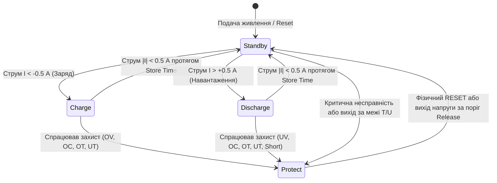

# Внутрішня логіка та архітектура прошивки Vision BMS (V-LFP48100)

> **Акумулятор:** Vision V-LFP48100 (48 В, 100 А·год, 15S LiFePO4)  
> **Прошивка контролера BMS:** `V10R18`  
> **Конфігурація моделі:** `LFP-15SP10G3-100Ah-100A`  
> **Джерело даних:** Реверс-інжиніринг супер-кадру 91 регістру утиліти `BMS_TOOLS 2.2.01`, дизасемблювання команд керування, аналіз знятих телеметричних логів та польових тестів.

---

## 1. Апаратна база та архітектура контролера BMS

Контролер BMS акумулятора Vision V-LFP48100 побудований на базі спеціалізованого AFE-чипа (Analog Front End) у парі з керуючим мікроконтролером:
* **Канали вимірювання напруги:** 15 незалежних диференційних входів (Cell 01 .. Cell 15), розрядність вимірювання 1 мВ.
* **Канали температури:** 4 NTC-терморезистори (2 датчики всередині блоків комірок $T_1, T_2$, 1 датчик радіатора силових транзисторів $T_{MOSFET}/T_{PCB}$, 1 датчик навколишнього середовища $T_{Ambient}$).
* **Вимірювання струму:** двонаправлений низькоомний токовий шунт із підсилювачем сигналу; роздільна здатність 10 мА (0.01 А).
* **Силова комутація:** два зустрічно включені блоки N-канальних силових MOSFET-транзисторів — **Charge MOS** (зарядний ключ) та **Discharge MOS** (розрядний ключ).
* **Балансувальні ланцюги:** 15 незалежних пасивних шунтів (розрядний SMD-резистор + біполярний/MOSFET транзистор керування на кожен осередок). Струм балансування становить **$50\text{–}70\text{ мА}$** (теплова потужність розсіювання $\approx 0.2\text{ Вт}$ на комірку).

---

## 2. Кінцевий автомат станів акумулятора (BMS State Machine)

У внутрішній прошивці батареї реалізовано детермінований кінцевий автомат (FSM). Поточний системний стан транслюється у **Регістрі 25 (`0x0019`)**:

### Деталізація станів:

1. **`0x0000` — Standby (Режим очікування / Сон):**
   * **Умова входу:** Струм на клемах перебуває в межах нуля ($|I| < 0.5\text{ А}$) довше заданого інтервалу спокою (`Store Time`, регістр 43).
   * **Стан ключів:** Ключі перебувають у черговому режимі. Контролер переходить на низьку частоту вимірювання (200–500 мс).
   * **Особливість:** Пасивні балансири заблоковані або швидко вимикаються через падіння напруги комірок без струмової підтримки.
2. **`0x0001` — Charge (Заряд):**
   * **Умова входу:** На зовнішніх силових клемах фіксується струм заряду ($I \le -0.5\text{ А}$).
   * **Стан ключів:** Зарядний MOSFET повністю відкрито. Активується внутрішній алгоритм моніторингу дельт та балансування.
3. **`0x0002` — Discharge (Розряд):**
   * **Умова входу:** Фіксується струм розряду на навантаження ($I \ge +0.5\text{ А}$).
   * **Стан ключів:** Розрядний MOSFET відкрито. Працюють алгоритми захисту від перерозряду та перевантаження по струму.
4. **`0x0004` — Protect (Аварійне апаратне блокування):**
   * **Умова входу:** Спрацювання будь-якого із захисних компараторів (перезаряд комірки `Cell OV`, перерозряд `Cell UV`, перегрів, мороз, струмовий удар).
   * **Стан ключів:** **Апаратний розрив силового ключа.**
   * **Поведінка інтерфейсу:** BMS продовжує відповідати на опитування Modbus RS-485, але **ігнорує будь-які програмні команди відкриття ключів (FC06 до регістра 42 `0x002A`)**.
5. **`0x0008` — Charge Limit (Струмообмеження глибокого розряду):**
   * **Умова входу:** Напруга на клемах нижче **`45.00 В`** (`Enter Voltage Limit`, регістр 48).
   * **Стан ключів:** Зарядний струм обмежується внутрішнім резистивним ланцюгом м'якого заряду, запобігаючи перегріву розряджених банок до підняття напруги в безпечну зону.

---

## 3. Алгоритм стадій заряду та переходу у Float

Контролер BMS Vision має власні зашиті уставки керування стадіями заряду (регістри 48, 53, 54, 55):

| Параметр | Регістр | Заводська уставка | Призначення в алгоритмі |
|---|---|---|---|
| **Enter Voltage (Limit)** | 48 (`0x0030`) | **45.00 В** (3.00 В/ком) | Поріг активації м'якого заряду зі струмообмеженням при глибокому розряді |
| **Enter Float Vol** | 53 (`0x0035`) | **52.50 В** (3.50 В/ком) | Поріг автоматичного переходу внутрішньої логіки BMS у буферний режим (Float) |
| **Quit Float Vol** | 54 (`0x0036`) | **51.75 В** (3.45 В/ком) | Поріг повернення з Float у стадію поповнення ємності (Bulk/Absorption) |
| **Float Style** | 55 (`0x0037`) | `1` (By Voltage) | Регулювання буферного режиму за сумарною напругою банку |

---

## 4. Алгоритм роботи внутрішніх балансирів (Cell Balancing)

Внутрішня мікропрограма опитує стан усіх 15 комірок і розраховує бітову маску балансування (**Регістр 38 / `0x0026`**).

### Умови ввімкнення розрядного ключа комірки:
Ключ балансування конкретної комірки активується **виключно при одночасному виконанні 3 умов (логічне ТА)**:
$$\text{Balancing ON} = (U_{cell} \ge 3400\text{ мВ}) \ \land \ (U_{cell} - U_{min\_cell} \ge 40\text{ мВ}) \ \land \ (\text{State} == \text{Charge})$$

1. **Поріг напруги комірки:** $U_{cell} \ge \mathbf{3400\text{ мВ}}$ (`Balance Vol`, регістр 56). На пологій ділянці кривої LiFePO4 ($< 3.40\text{ В}$) балансування повністю заблоковане для унеможливлення помилкового зливання ємності.
2. **Дельта дисбалансу:** $\Delta U \ge \mathbf{40\text{ мВ}}$ (`Balance Diff`, регістр 57). Комірка вважається лідером, якщо вона випереджає найслабшу комірку блоку щонайменше на 40 мВ.
3. **Наявність зарядного струму:** Батарея повинна бути у фазі заряду або утримання Float.

### Чому балансири засинають без зовнішньої підтримки?
Електрохімія LiFePO4 має властивість швидкої релаксації: щойно зовнішній струм заряду падає до нуля, напруга на комірках за лічені хвилини спадає з 3.55–3.60 В до рівноважних 3.36–3.38 В. Як наслідок, умова $U_{cell} \ge 3400\text{ мВ}$ перестає виконуватися, і BMS миттєво знімає керування з пасивних ключів, перериваючи вирівнювання.

---

## 5. Матриця апаратних захистів та гістерезис відновлення (Safety Matrix)

Всі пороги захисту прошиті в енергонезалежній пам'яті EEPROM контролера BMS і контролюються апаратно-програмним комплексом:

| Аварійний фактор | Поріг тривоги (Warn) | Поріг відсікання (Protect) | Затримка (Delay) | Умова відновлення (Release Hysteresis) | Регістри (W / P / Rel) |
|---|---|---|---|---|---|
| **Перезаряд комірки (Cell OV)** | 3600 мВ | **3650 мВ** | миттєво | $U_{cell} \le \mathbf{3400\text{ мВ}}$ або фізичний **RESET** | 67 / 68 / 69 |
| **Перезаряд банку (Pack OV)** | 54.50 В | **55.00 В** | миттєво | $U_{pack} \le \mathbf{52.50\text{ В}}$ | 70 / 71 / 72 |
| **Перерозряд комірки (Cell UV)** | 2800 мВ | **2500 мВ** | миттєво | $U_{cell} \ge \mathbf{3000\text{ мВ}}$ (під зовнішнім зарядом) | 61 / 62 / 63 |
| **Перерозряд банку (Pack UV)** | 43.20 В | **42.00 В** | миттєво | $U_{pack} \ge \mathbf{46.00\text{ В}}$ | 64 / 65 / 66 |
| **Струм заряду Ступінь 1 (Chg OC1)** | 100.0 А | **102.0 А** | 20 с | Пауза **180 с** (ліміт: 5 спроб) | 80 / 85 / 78 |
| **Струм заряду Ступінь 2 (Chg OC2)** | — | **112.0 А** | 3 с | Пауза **180 с** (ліміт: 5 спроб) | 83 / 86 / 78 |
| **Струм розряду Ступінь 1 (Dis OC1)**| 100.0 А | **102.0 А** | 30 с | Пауза **60 с** (ліміт: 5 спроб) | 81 / 87 / 79 |
| **Струм розряду Ступінь 2 (Dis OC2)**| — | **122.0 А** | 3 с | Пауза **60 с** (ліміт: 5 спроб) | 84 / 88 / 79 |
| **Коротке замикання (Short Circuit)**| — | **$\ge 300.0\text{ А}$** | $\le 100\text{ мкс}$ | Ручний перезапуск (RESET) | 82 |
| **Заряд на холоді (Charge UT)** | $-3\ ^\circ\text{C}$ | **$-5\ ^\circ\text{C}$** | 1 с | $T \ge \mathbf{0\ ^\circ\text{C}}$ | 90 / 91 / 92 |
| **Перегрів при заряді (Charge OT)** | $+65\ ^\circ\text{C}$ | **$+70\ ^\circ\text{C}$** | 1 с | $T \le \mathbf{+60\ ^\circ\text{C}}$ | 93 / 94 / 95 |
| **Розряд на морозі (Discharge UT)** | $-20\ ^\circ\text{C}$ | **$-25\ ^\circ\text{C}$** | 1 с | $T \ge \mathbf{-15\ ^\circ\text{C}}$ | 96 / 97 / 98 |
| **Перегрів при розряді (Discharge OT)**| $+70\ ^\circ\text{C}$ | **$+75\ ^\circ\text{C}$** | 1 с | $T \le \mathbf{+65\ ^\circ\text{C}}$ | 99 / 100 / 101 |
| **Перегрів плати MOSFET (PCB OT)** | $+90\ ^\circ\text{C}$ | **$+95\ ^\circ\text{C}$** | 1 с | $T \le \mathbf{+80\ ^\circ\text{C}}$ | 102 / 103 / 104 |

---

## 6. Поведінка MOSFET-ключів та інтерфейс керування

### Керування ключами через Modbus (`Switch Control`, Регістр 42 / `0x002A`):
BMS підтримує запис функції FC06 у регістр 42:
* `0x0001` — примусове ввімкнення Charge MOSFET.
* `0x0002` — примусове ввімкнення Discharge MOSFET.
* `0x0004` — примусовий перехід у Sleep.

### ⚠️ Чому команди розблокування ігноруються під час аварії Protect?
У прошивці контролера реалізовано **безумовний апаратний пріоритет захисту (Hardware Interlock)**:
1. Якщо в регістрі 27 активний будь-який біт аварії (наприклад, біт `0x0002` — `Cell OV`), мікроконтролер переводить драйвер затворів MOSFET у стан розриву.
2. Будь-які запити запису `FC06` до регістра `0x002A` або квитування помилок по шині RS-485 **відхиляються або ігноруються** логікою безпеки.
3. Повернути ключ у робочий стан можна лише двома шляхами:
   * **Автоматично:** дочекатися, поки фізична напруга комірки-лідера під дією саморозряду або пасивного резистора опуститься нижче порогу відновлення **$3400\text{ мВ}$** (`Cell OV Release`).
   * **Вручну:** короткочасно натиснути фізичну кнопку **RESET** на лицьовій панелі акумулятора. Це викликає апаратний перезапуск мікроконтролера BMS (Cold Boot), скидання латчів аварій та повторну ініціалізацію силових ключів.

---

## 7. Алгоритм кулонометра (Підрахунок SOC та ємності)

Вбудований у BMS кулонометр обчислює залишкову ємність (Регістр 21, А·год) та відсоток заряду (Регістр 24, SOC %):

$$\text{Capacity}_{rem}(t) = \text{Capacity}_{rem}(t_0) + \frac{1}{3600} \int_{t_0}^t I(\tau) \, d\tau$$

### Апаратні реперні точки синхронізації:
1. **Калібрування 100%:** Виставляється за умови, коли напруга досягає напруги повного заряду ($V_{pack} \ge 53.5\text{ В}$, $U_{cell\_max} \ge 3.55\text{ В}$), а струм заряду падає до величини струму відсікання ($|I| < 1.0\text{ А}$).
2. **Калібрування 0%:** Виставляється при досягненні порогу аварійного розряду або порогу `Low Capacity Warn` (5%, регістр 58).

### Причини розкалібрування та зависання кулонометра:
* LiFePO4 має надзвичайно пласку залежність напруги від заряду на ділянці 20–80%. У цьому діапазоні контролер спирається суто на інтегрування сигналу з токового шунта.
* Підсилювач шунта АЦП має дрейф нуля ($\pm 50\text{–}100\text{ мА}$). За тижні експлуатації в режимі неповних циклів математична похибка інтегрування накопичується, спричиняючи відомий ефект «зависання кулонометра на 100%» або раптового стрибка відсотків при зміні навантаження.

---

## 8. Підсумок: Відоме vs Невідоме

| Компонент логіки BMS | Рівень повноти | Що саме відомо / зафіксовано |
|---|---|---|
| **Регістрова мапа Modbus** | **100%** | Усі 91 регістр супер-кадру, типи даних, множники, зміщення. |
| **Пороги захистів і таймінги** | **100%** | Усі напруги відсікання/скидання, струми OC1/OC2/Short, температурна матриця. |
| **Кінцевий автомат станів (FSM)**| **100%** | Коди станів (Standby, Charge, Discharge, Protect, Charge Limit) та умови переходів. |
| **Логіка балансирів** | **100%** | Поріг старту 3400 мВ, поріг дельти 40 мВ, струм шунтів ~50–70 мА. |
| **Комутація ключів MOSFET** | **100%** | Пріоритет апаратного захисту над командами RS-485, механізм RESET. |
| **Внутрішні калібрування АЦП** | *~80% (другорядне)* | Коефіцієнти фільтрації цифрового шуму АЦП зашиті в бінарний код MCU, але на експлуатаційну логіку не впливають. |

