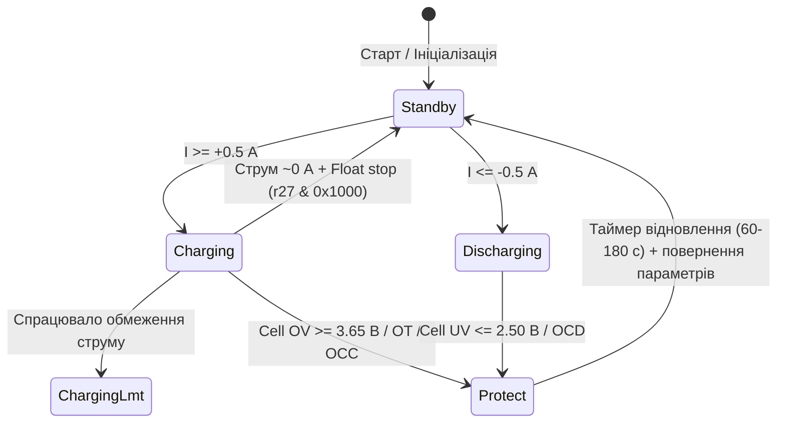

# Протокол та внутрішня логіка BMS Vision `V-LFP48100`

Технічний довідник апаратної архітектури, внутрішнього кінцевого автомата, команд Modbus RTU та повної карти регістрів батарей **Vision `V-LFP48100`** (прошивка **`V10R18`**, апаратна конфігурація **`LFP-15SP10G3-100Ah-100A`**).

---

## 1. Апаратна платформа й адресація

* **Конфігурація:** **15S LiFePO4**, номінал `48.0 В` (100 А·год), серійні номери зразка `2025040900109522` / `202504090106194`.
* **Силові ключі:** Незалежні MOSFET-каскади заряду (`CHG_MOS`) та розряду (`DSG_MOS`), плюс обмежувач пускового струму заряду (~10 А при старті/обмеженні).
* **Балансування комірок:** Пасивний резистивний баланс (`~50–70 мА`, ~0.2 Вт на канал). Умови активації всередині BMS: `U_cell >= 3400 мВ`, `ΔU >= 40 мВ`, наявність активного стану **Charge** (тому на холостому ходу або у Float баланс зазвичай спить).
* **Термодатчики:** До 6 пакованих NTC (`Temp01..Temp06` у рег. `33..35`) + окремий датчик плати/MOSFET **`Temp PCB`** у регістрі **`18` (`0x0012`)**.
* **Адресація DIP на лицьовій панелі батареї:** Фізичні важелі `1..4` рахуються **справа наліво**: крайній правий = LSB (вага +1), крайній лівий = MSB (вага +8); важіль ВГОРУ = `ON` (+вага). Живо підтверджені адреси опитування **`0x01..0x0F`**. Якщо всі важелі опущені вниз — заводська документація вказує `Master BMS = 0x10`, але на живому ланцюзі без такої конфігурації `0x10` не відповідає.
* **Шина:** **RS485 Modbus RTU**, **9600 8N1**, напівдуплекс (`Pin 2 = A+`, `Pin 1 = B−`, `GND`).

---

## 2. Внутрішній кінцевий автомат BMS (FSM) і кулонометр

* **Режим `Float Style` всередині BMS:** Заводський алгоритм після повного заряду виставляє інформаційний біт **`0x1000` (`Float stop`)** у регістрі `0x001B` (`r27`), переходить у `Standby` і чекає зниження напруги банку до **`52.50 В` / `51.75 В`** перед новим циклом.
* **Проблема апаратного кулонометра (`r24` SOC):** Через апаратний дрейф нуля шунта (`±50..100 мА`) або відсутність тривалих повних розрядів-зарядів вбудований лічильник `SOC` здатний «зависати» на `>= 99%` навіть при напрузі нижче `CVL − 1.0 В` (`53.0 В` для Vision, `52.2 В` для Victron, `50.0 В` для Float; реальний залишок ~60–70%). Тому COM-Box використовує гібридну модель: **`Smart Coulomb Fallback` + 3-режимна OCV-оцінка**.
* **Апаратне керування пробудженням (`FC06`):** Запис `FC06` у регістр **`0x002A`** значення **`0x0001`** (`BMS_WAKEUP_QUERY_TABLE`) стимулює активність BMS і скидає стан сплячки при циклі балансування (`DIP5=ON` / баланс-сесія).

---

## 3. Команди Modbus RTU на шині

| Ініціатор | Команда (hex) | Діапазон регістрів | Розмір відповіді | Призначення |
|---|---|---|---|---|
| **COM-Box** (робочий цикл) | `addr 03 00 00 00 27` | `0x0000..0x0026` (`0..38`, qty=39) | **83 байти** (`0x4E` = 78B даних) | Основна телеметрія, комірки 1..15, статуси та аварії |
| **COM-Box** (`Smart Plug & Play`) | `addr 03 00 69 00 17` | `0x0069..0x007F` (`105..127`, qty=23) | **51 байт** (`0x2E` = 46B даних) | Модель, версія FW (`V10R18`), серійний номер |
| **COM-Box** (пробудження) | `addr 06 00 2A 00 01` | `0x002A` (`42`) | **8 байтів** (луна) | Імпульс пробудження під час активного балансування (кожні 3 с по черзі) |
| **Інвертор Deye** (прямий RS485) | `addr 03 00 00 00 1C` `addr 03 00 50 00 02` | `0..27` (qty=28) `80..81` (qty=2) | 61 байт 9 байт | Deye **НЕ зчитує** `r28..r38` (Error, Cycles, Cell NTC `Temp01..04`, Bal bits) |
| **BMS_TOOLS 2.2.01** (ПК) | `addr 03 00 2D 00 5B` | `0x002D..0x0087` (`45..135`, qty=91) | 187 байтів | Розширені заводські пороги EEPROM, параметри захистів, калібрування |
| **BMS_TOOLS 2.2.01** (керування) | Суб-запити `BMS Control` | — | — | Ручне керування `S40O1..S40O4`, 12 каналів `Warn Switch`/`Protect Switch`, `DateTime`, `Del record`, `Restore Factory Data` |

---

## 4. Карта регістрів Modbus (`FC03`, 16-біт Big-Endian)

### 4.1. Оперативна телеметрія (`0x0000..0x0026`, qty=39)

У 83-байтовому кадрі регістр `r` знаходиться за зміщенням байтів `[3 + 2*r]` (Hi) і `[4 + 2*r]` (Lo); CRC16-Modbus у кінці `[81..82]` іде у форматі Little-Endian.

| Reg (Dec) | Addr (Hex) | Параметр | Тип / Масштаб | Примітка та перевірені факти |
|---:|:---:|---|---|---|
| `0` | `0x0000` | **Pack Voltage** | `uint16` / 100 (`0.01 В`) | Наприклад, `4945` = `49.45 В` |
| `1` | `0x0001` | **Pack Current** | **`int16`** / 100 (`0.01 А`) | **Знак BMS:** `+` = заряд, `−` = розряд *(у CAN `0x356` інвертується!)* |
| `2..16` | `0x0002..0x0010` | **Cell 1..15 Voltage** | `uint16` (`1 мВ`) | Індивідуальні напруги 15 комірок |
| `17` | `0x0011` | **Cell 16 Voltage** | `uint16` (`1 мВ`) | Завжди `0` на 15S-батареї |
| `18` | `0x0012` | **`Temp PCB`** | `int16` (`1 °C` або сирий MOS) | ⚠️ **Це температура MOSFET/плати, НЕ комірок!** Відокремлено від температур комірок у прошивці з 14.11.2026 |
| `19` | `0x0013` | **`Temp Avg`** | `int16` (`1 °C`) | Середня температура датчиків |
| `20` | `0x0014` | **`Temp Max`** | `int16` (`1 °C`) | Максимальна температура |
| `21` | `0x0015` | **Remaining Capacity** | `uint16` (`1 А·год`) | Цілі ампер-години, напр. `49`–`50` при SOC 49% на 100 А·год блоці *(до виправлення P1.1 помилково читалось замість SOC)* |
| `22` | `0x0016` | **Max Charge Capacity / Limit** | `uint16` | Повна/розрахункова ємність або межа заряду |
| `23` | `0x0017` | **SOH** | `uint16` (`%`, береться `& 0xFF`) | Стан здоров'я батареї |
| `24` | `0x0018` | **SOC** | `uint16` (`%`) | Апаратний кулонометр BMS *(може залипати на 100% — контролюється COM-Box)* |
| `25` | `0x0019` | **Status** | Бітова маска + Enum | Молодший байт: `0x00=Standby`, `0x01=Charging`, `0x02=Discharging`, `0x04=Protect`, `0x08=Charging Lmt`; біт `0x8000 = Heating ON` |
| `26` | `0x001A` | **Warning Flags** | 16-бітна маска | Біти `0..11` базові (див. `SAFETY_AND_ALARMS.md`) + `0x1000 = Low Capacity` (`SOC 1..4%`) |
| `27` | `0x001B` | **Protection Flags** | 16-бітна маска | Біти `0..11` базові; `0x1000 = Float stop` *(не аварія!)*; `0x2000 = Short Circuit`; `0x4000 = Reverse` |
| `28` | `0x001C` | **Error Code** | 16-бітна маска | `0x0001 Voltage err`, `0x0002 Temp err`, `0x0004 Current sensor`, `0x0010 Cell unbalance` |
| `29..30` | `0x001D..0x001E` | **Cycle Count** | `uint32` BE (`(r29<<16)|r30`) | Кількість повних циклів |
| `31..32` | `0x001F..0x0020` | **Full Charge Capacity** | `uint32` BE (`mAs / C`) | `((r31 << 16) | r32) / 3.6e6` → ємність у `А·год` |
| `33..35` | `0x0021..0x0023` | **`Temp01..Temp06`** | 6 × `int8` (Hi/Lo байти) | Окремі фізичні NTC-сенсори (`Temp01..Temp04` комірок тощо) |
| `36` | `0x0024` | **Cell Number** | `uint16` | Кількість комірок (`15`) |
| `37` | `0x0025` | **Designed Capacity** | `uint16` (`0.1 А·год`) | Наприклад, `1000` = `100.0 А·год` |
| `38` | `0x0026` | **Balance Status** | Бітова маска | Біти `0..14` → індикація активного пасивного балансира на комірці `1..15` |

### 4.2. Розширений блок та ідентифікація (`0x002D..0x0087`)

| Діапазон | К-сть рег. | Зміст блоку |
|---:|:---:|---|
| `0x002D..0x0068` (`45..104`) | 60 | **EEPROM налаштувань BMS (`BMS_TOOLS 2.2.01`):** `Cell OVP = 3.65 В` (`Warn 3.60 В`, `Rel 3.40 В`), `Cell UVP = 2.50 В` (`Warn 2.80 В`, `Rel 3.00 В`), `Float Style = 52.50 / 51.75 В`, `Charge UT = -3 / -5 °C`, `Cells OT = 70 / 75 °C`, `PCB OT = 90 / 95 °C` |
| `0x0069..0x0074` (`105..116`) | 12 | **Model** (ASCII 2 символи/регістр): `LFP-15SP10G3-100Ah-100A` |
| `0x0075..0x0077` (`117..119`) | 3 | **Firmware Version** (6 байтів ASCII): напр. `V10R18` |
| `0x0078..0x007F` (`120..127`) | 8 | **Serial Number** (16 байтів ASCII): напр. `2025040900109522` |
| `0x0080..0x0087` (`128..135`) | 8 | Хвіст розширеного кадру (параметри калібрування / резерв) |

---

## 5. Відомі особливості та «підводні камені» прошивки BMS Vision

1. **Прихований біт `0x1000` у `BMS_TOOLS`:** У програмі `BMS_TOOLS 2.2.01` візуальна сітка `Protect Status` пропускає позицію `0x1000` (стрибає з `0x0800` на `0x2000 Short Circuit`), натомість виводячи **`0x1000` як `Float stop`** у панелі попереджень після завершення заряду (`Standby`, `SOC 100%`, `I = 0`).
2. **Транзиторний Boot Latch:** При старті або відновленні після глибокого сну BMS може видавати залишкові біти в `r26`/`r27` протягом перших секунд попри нормальну напругу комірок — вимагає фізичної крос-валідації на боці COM-Box.
3. **Заниження активності при `qty=28`:** Інвертор Deye при прямому підключенні по RS485 читає лише `0..27` + `0x50`, тому не бачить реальних `Error Code` (`r28`), статусів індивідуального балансування (`r38`) і розкладених датчиків `Temp01..Temp04` (`r33..34`).
